# todaytec.com.vn — theme, SEO and brand audit, compared with todaytec.com

| | |
|---|---|
| Requested by | Boss (owner, Todaytec Vietnam) |
| Audit date | 30 Oct 2026 (live checks 12:55–13:50 UTC) |
| Sites | https://todaytec.com.vn/ (VN store) · https://todaytec.com/ (global site) |
| Data sources | Live HTML/CSS/JS from both sites; Playwright/Chromium 153 lab runs; GSC export in Supabase `seo.seo_gsc_page_daily` and `seo.seo_gsc_query_page_daily` (site_id 1, data to 27 Oct 2026); Todaytec Visual Identity 2024 PDF (pp. 9–15, 24–28, 33–36, 45); TDT design system README |
| Plan window | T11 (Nov 2026) and T12 (Dec 2026) |

> **Platform correction.** todaytec.com.vn does not run on Shopify. It runs on **Haravan**, the Vietnamese e-commerce platform. Haravan themes use Liquid with a Shopify-like file layout, but the platform's features differ. Every Liquid location in this document is a Haravan theme file. Where we could not confirm what Haravan supports, we say so instead of guessing (see §11).

---

## 1. Executive summary

**Theme identified (Haravan markers in the page source):**

```html
Haravan.shop = 'todaytec.myharavan.com';
Haravan.theme = {"name":"New multilanguage","id":1001476833,"role":"main"};
Haravan.domain = 'todaytec.com.vn';
```

- Shop id `200000930815` appears in the `x-shopid` header and in the asset paths.
- Theme assets are served from `cdn.hstatic.net/themes/200000930815/1001476833/14/…?v=748`.
- robots.txt says: `# we use Haravan as our ecommerce platform`.
- Templates seen in the source (`template-*` body class and `multi_template`):
  - `index`, `collection`, `product`, `article`, `blog`, `page`, `404`;
  - the alternate templates `article.vi`, `blog.en`, `page.about-us` and `page.contact`.

### Ten things that matter most

1. **The October collection redirects are not live.** On 30/10 all eight old English collection URLs we tested returned **404, not 301**. Examples: `/collections/wax-ribbon`, `/collections/resin-ribbon`, `/collections/wax-resin-ribbon`, `/collections/wash-care-ribbon` and `/collections/ribbon-dap-nhiet-tto-wax-resin-ribbon`. Six other URLs from GSC also return 404.
   - In January 2026 these old series collections earned 533 clicks and 2,573 impressions, at average position 4.8.
   - GSC has **80 URLs with at least 5 impressions in 2026** that are no longer in the sitemap. They are candidates for 404s.
2. **Four of the seven keywords that dropped lost their landing page to a 404:** "TTO ribbon", "ribbon wax", "ribbon resin" and Wash Care ("ribbon in nhãn mác quần áo").
   - The other three map to blog posts. Those posts return 200, have a self-referencing canonical and are indexable, so their drop is not technical.
   - Site-wide clicks fell **94 %, from 2,405 in January to 137 in June 2026**, before the migration happened.
3. **The HTML is 914,054 bytes because every template inlines its libraries.**
   - About 91 % of the home HTML is inline JavaScript (486 KB), inline CSS (302 KB) and inline SVG (45 KB).
   - The inline code includes Swiper, Bootstrap (JS and CSS), jQuery (also loaded a second time as a file), the "Soon" countdown and Popper.
   - Inline JSON (265 B) and base64 (0.8 KB) are *not* the cause.
   - The same bloat repeats on every page. Even the 404 page weighs 810 KB.
4. **A 20.7 MB autoplay hero MP4.**
   - The home page has two `<video>` elements that point to the same file.
   - A desktop visit to the home page downloaded **23.1 MB in total, 20.3 MB of it the video**.
   - On a Slow-4G iPhone emulation, LCP was 11.8 s.
5. **An obfuscated "PageSpeed" script (`f1genzPS`) changes what Lighthouse sees.**
   - It detects Lighthouse's platform fingerprint and holds back scripts.
   - Lighthouse-style emulation loaded 37 requests (1.2 MB). An iPhone-like profile loaded 100 requests (2.5 MB).
   - In the Lighthouse view the layout is broken: 1,435 px wide, with missing images.
   - PageSpeed scores for this site cannot be trusted. Googlebot's rendering must be checked in GSC.
6. **The lead conversion fires on every page view.**
   - The event `conversion_event_submit_lead_form`, including the Google conversion ping `google.com/measurement/conversion…&en=conversion_event_submit_lead_form`, fired on **11 of 11 page loads**, with no form submitted.
   - This inflates GA4 conversions, and Google Ads conversions if they are imported.
   - Google Ads is connected in Haravan › Marketing.
7. **Junk and duplicate URLs are indexable and listed in the sitemap.**
   - `/pages/frontpage` still carries Haravan's placeholder text ("Viết vài dòng giới thiệu…").
   - `/blogs/news/bai-viet-mau` is Haravan's sample article.
   - `/blogs/news` has a "Lorem ipsum" meta description.
   - Other junk: `/collections/frontpage|onsale|hot-products|all`, `/collections/types?q=…` and `/blogs/all/tagged/…`.
   - In January these junk listing URLs had 982 impressions; in October (1–27) they had 257.
8. **Structured data is minimal.**
   - The only JSON-LD on any page is `WebSite` with a `SearchAction`.
   - The Product microdata sits inside `<head>` and has **`price` 0 VND**, no SKU and no description.
   - There is no Organization or LocalBusiness detail, and no Article markup.
   - The home H1 is hidden (`<h1 style="display:none">…Todaytec</h1>`).
9. **todaytec.com is not a technical SEO model.**
   - It has no canonical tags, no XML sitemap (`/sitemap.xml` returns 302 to a 404 page), no Open Graph and no JSON-LD.
   - Every product page has the same title ("TTR Solution-Todaytec Digital").
   - Bad URLs get a soft 404 (302 → `/404` returning 200, titled "Document"), and `www` duplicates the host.
   - What .com does well is **IA, product-data presentation, brand look and front-end weight**. Each HTML page transfers 8–16 KB, JS totals 138 KB, and there are no third-party hosts.
10. **Brand deviations on VN.**
    - Headings use a **blue→teal gradient with an off-palette blue `#004EA2`** (22 CSS rules).
    - The six series functional colours are unused (0 CSS hits).
    - Small white text on teal has a contrast ratio of 3.76:1.
    - Article body text is in Arial, and spec values are images set in a serif font.
    - Article hero images have the logo stamped on the photo.
    - The VN site uses Roboto, which complies; .com renders in Arial, which does not.

### Answer to Boss: "Chỉnh theo todaytec.com trong T11 & T12 thì sao?"

**Yes to its look, information architecture and product template. No to its URLs and its SEO setup.**

- **T11 (November):** technical fixes only, with **no new URL changes**. This includes finishing the September/October migration by putting back the missing 301s.
- **T12 (December):** rebuild the templates to the .com and VI 2024 look on a **duplicated, unpublished Haravan theme**, then publish only after QA.
  - Collection, product and article handles stay as they are.
  - The redirect map stays as it is.
  - The CWV budget must be met.

The details are in §10.

---

## 2. Method and limits

**Crawl.** We made about 68 page-level requests to todaytec.com.vn, including 11 browser loads, and about 56 to todaytec.com, spaced 1.5–2.5 s apart. Status codes were checked hop by hop with curl. On-page data was parsed from the raw HTML.

**Lab performance.** We used Playwright with Chromium 153 and recorded each request's transfer size through CDP:

| Profile | Viewport | Throttling | User agent / platform |
|---|---|---|---|
| Desktop | 1440×900 | None | Linux Chrome |
| Mobile | 390×844 at DPR 2 | Slow-4G-like (1.6 Mbps, 150 ms RTT) and 4× CPU | iPhone |

- VN mobile was run twice: once with Chromium's default Linux platform (the "Lighthouse view") and once with `navigator.platform` set to `iPhone` (the "iPhone view"). See finding D2.
- These are **lab numbers from a sandbox behind an egress proxy**. Treat them as relative, not as field Core Web Vitals.
- **PageSpeed Insights API:** four calls without a key all returned **HTTP 429** ("Quota exceeded … Queries per day"), so there are no PSI or CrUX numbers in this report.

**GSC.** The data is page-level and query-level from Supabase, through 27 Oct 2026. October figures cover 1–27 Oct only.

**Not done.**
- No Liquid file was read; there is no theme access yet (see §12).
- `http://` behaviour could not be tested: plain HTTP does not resolve through the sandbox proxy.
- Of the 80 GSC URLs missing from the sitemap, we status-checked only 17.

---

## 3. Findings (todaytec.com.vn)

Severity: **P0** = losing traffic or data now · **P1** = significant · **P2** = hygiene.

### A. Crawl and index

| ID | Sev | URL | Evidence (exact) | SEO/UX impact |
|---|---|---|---|---|
| A1 | P0 | `/collections/wax-ribbon`, `/collections/resin-ribbon`, `/collections/wax-resin-ribbon`, `/collections/wash-care-ribbon`, `/collections/ribbon-dap-nhiet-tto-wax-resin-ribbon`, `/collections/wax-ribbon-1`, `/collections/hot-stamping-foil-1`, `/collections/wash-care-ribbon-en` | `HTTP 404`, no `Location` header. Same result with browser and Googlebot user agents. The response is the 404 template with `<title> Không tìm thấy trang – Todaytec </title>` and `<link rel="canonical" href="" />`. | The equity of the old series URLs is lost. The four main ones had 19,248 impressions since Jul 2025 (wax 5,937, resin 6,691, wax-resin 4,431, wash care 2,189), including 10,141 impressions and 1,353 clicks in Jan–Oct 2026. The new URLs had to start from zero: October showed 277 impressions at average position 17.6. |
| A2 | P0 | `/products/wash-care-tdr380-1`, `/pages/about-todaytec`, `/pages/product-range-comparison`, `/blogs/news/ruy-bang-muc-in-ma-vach-la-gi-vi-sao-phai-chon-dung-todayte`, `/blogs/news-todaytec/common-thermal-transfer-ribbon-issues-and-how-to-fix-them`, `/blogs/news-todaytec/barcode-ribbon-for-the-electronics-component-industry-the-optimal-al` | All `404`. In 2026 GSC they had 183, 1,476, 176, 1,139, 509 and 697 impressions. | The same equity loss, now affecting product and page URLs too. Of the 80 GSC URLs (≥5 impressions in 2026) missing from the sitemap, 17 were fetched: 14 return 404, and 3 are live listing pages (`/collections/all`, `/blogs/news`, `/blogs/all/tagged/wax-ribbon`). The other 63 were **not** fetched; they are in the §9 map for bulk checking. |
| A3 | P1 | `/collections/all`, `/collections/frontpage`, `/collections/onsale`, `/collections/hot-products`, `/pages/frontpage`, `/collections/types?q=*`, `/blogs/all/tagged/*` | All return `200` and a self-canonical. None has `meta robots`. `/collections/frontpage`, `/collections/onsale`, `/collections/hot-products` and `/pages/frontpage` are in `sitemap_collections_1.xml` / `sitemap_pages_1.xml`. Example: `/collections/types?q=premium-enhanced-resin-ribbon` → `<title>– Todaytec</title>`, empty H1. | Thin or duplicate listings are indexed and compete with the series collections. For "ribbon resin" in October, `/collections/types?q=premium-enhanced-resin-ribbon` was at position 68.7 and `…white-wash-care-resin-ribbon-en` at 35.5. |
| A4 | P1 | `/pages/frontpage`, `/blogs/news/bai-viet-mau`, `/blogs/news` | `/pages/frontpage` meta description: "Viết vài dòng giới thiệu với khách hàng về cửa hàng của bạn…" (Haravan's placeholder). `bai-viet-mau` description: "Đây là trang blog của cửa hàng…", title "Bài viết mẫu". `/blogs/news` meta description: "Lorem ipsum dolor sit amet consectetur…". | Unprofessional snippets on indexed URLs; `/pages/frontpage` had 488 impressions in 2026. |
| A5 | P1 | `/pages/about-us` and `/pages/gioi-thieu` | Same template (`page.about-us`), same H1 "VỀ CHÚNG TÔI", same title "Giới thiệu – Todaytec". Each has a self-canonical. | Duplicate content split across two URLs (1,587 and 1,384 impressions in 2026). |
| A6 | P2 | 4 articles `/blogs/news/in-nhan-quoc-te-chau-a-ket-thuc-thanh-cong-tiandi-digital-rat-mong-du`, `-1`, `-2`, `-3` | All four are listed in `sitemap_blogs_1.xml`. | Probably duplicates; the content still needs checking. |
| A7 | P2 | `/collections/muc-in-ma-vach-wax?page=2` | `<link rel="canonical" href="https://todaytec.com.vn/collections/muc-in-ma-vach-wax" />` (canonical points to page 1). | Products on page 2 and later lose a crawlable path. Google advises a self-referencing canonical on paginated pages. |
| A8 | P2 | Every 404 | `<link rel="canonical" href="" />`, `og:url ""`, `hreflang href=""`. The 404 page weighs 809,917 bytes. | An invalid canonical, and a heavy error page. |
| A9 | ok | `/collections/x/products/y`, `?sort_by=`, `?view=vi` | `/collections/muc-in-ma-vach-wax/products/tdw132` → canonical `/products/tdw132` ✓. `?sort_by=price-ascending` → canonical to the clean collection ✓. `/blogs/news/muc-in-tto?view=vi` → canonical `/blogs/news/muc-in-tto` ✓. | Correct. Still, the home page links to `?view=vi` URLs 34 times (11 distinct URLs; e.g. `/blogs/news/muc-in-tto?view=vi` six times), which wastes crawl. |
| A10 | ok/P2 | robots.txt, sitemap | robots.txt is platform-generated. It disallows `/search`, `/cart`, `/checkout` and `/collections/*+*` filter combinations, and sets `Sitemap: https://todaytec.com.vn/sitemap.xml`. The sitemap index has 4 children: products 32, blogs 87, pages 18, collections 9 (all with `lastmod`). The sitemap comment says it "can not be edited manually". | Fine overall. The only lever over sitemap contents is publishing or hiding objects (see §11). |
| A11 | P2 | hreflang | `<link rel="alternate" href="https://todaytec.com.vn/" hreflang="vi-vn" />` is self-only and has no x-default. The VN site never links to todaytec.com. todaytec.com links to `http://www.todaytec.com.vn/` (http plus www → at least one redirect hop: `https://www.todaytec.com.vn/` → `301` → `/`). | Low impact (different languages and companies). Optional reciprocal hreflang is in the plan. |

### B. On-page

| ID | Sev | URL | Evidence | Impact |
|---|---|---|---|---|
| B1 | P1 | `/` | `<h1 style="display:none"><a href="https://todaytec.com.vn" itemprop="url">Todaytec</a></h1>` sits in the header, and the first visible heading is an `h3` "DANH MỤC NGÀNH HÀNG". The title is good: "Mực In Mã Vạch, Ruy Băng In Mã Vạch Chính Hãng \| Todaytec Việt Nam" (66 characters). The meta description is 308 characters, so it will be truncated. | No visible keyword H1 on the strongest URL, which had 889 clicks in 2026. |
| B2 | P1 | Collections | Wax: title 53 / description 141 ✓. Resin 55/155 ✓. Wax-Resin 63/146 ✓. **Wash Care: title "Wash Care Ribbon - Todaytec" (27), description 320 characters auto-cut from the body ("…I. Mô tả sản phẩm Wash Care RibbonWash Care Ribbon l")**. **TTO: description 320 characters auto-cut, H1 "Near-Edge/TTO Ribbon" against title "Ribbon Dập Nhiệt /TTO Wax/Resin Ribbon".** Hot Stamping title has 28 characters. | The Wash Care and TTO collections, both targets of lost keywords, have weak or auto-generated metadata. |
| B3 | P1 | Products | `/products/tdw132` title "TDW132 – Todaytec" (17). `/products/tdm240p` "Wax/ResinTDM240P – Todaytec" (27, missing space). `/products/wash-care-tdr380` description starts "Mô tả sản phẩm dành cho sản phẩmTDR380…" (320, auto-cut). `/products/resin-ribbon-tdr306` 58/115 ✓. | Product titles lack the series and use keywords ("ribbon resin chống trầy…"). |
| B4 | P2 | Articles | Article titles are 61–70 characters with a single H1 ✓. Author and date are visible ("bởi: Thao Hoang · 16 Tháng 09, 2025") ✓. Ten content images on `ruy-bang-muc-in-ma-vach-la-gi` have no alt. | Good base. Add Article schema (C3). |
| B5 | P1 | Home → products | The home page has **0 links to `/products/`**. It has 68 unique internal links, 39 of them to blog URLs (11 with `?view=vi`). | SKU pages get little internal PageRank. |
| B6 | P2 | Collections | The Wax collection has 115 `` elements, 98 without alt. **These 98 are decorative rating dots** (`file.hstatic.net/…/dot.png`, `dot2.svg`). Content images: 4 of 17 are missing alt. | Use `alt=""` or CSS for the dots; fill in alt for the content images. |
| B7 | P2 | Images | Product pages carry 33 PNG and 6 JPG content images and one WebP; 41 of 44 have no `width`/`height`. Images are lazy-loaded through `lazysizes` (`data-src`). | Heavier images; CLS risk (see D4). |
| B8 | P2 | OG/Twitter | OG is present on all templates. Products have `og:type product` with **`og:price:amount 0`**. `og:image` uses `http://` (with a `secure_url` fallback). There are **no `twitter:*` tags**. | A "0₫" price in shares; minor. |
| B9 | P1 | Collection SEO copy | The long collection copy ("I. Mô tả sản phẩm… IV. Tìm mua…") is collapsed behind "Xem thêm >>", and on mobile it sits above the product grid. | Fine for indexing. The UX should be checked so that the products come first on mobile. |

### C. Structured data (JSON-LD parsed, microdata inspected)

| ID | Sev | Template | Evidence | Impact |
|---|---|---|---|---|
| C1 | P1 | All | The only JSON-LD block (valid JSON) is `{"@context":"http://schema.org","@type":"WebSite","name":"todaytec.com.vn","url":"https://todaytec.com.vn","potentialAction":{"@type":"SearchAction","target":"https://todaytec.com.vn/search?&q={search_term_string}",…}}`. The `<body>` and header carry microdata `itemtype="http://schema.org/Organization"` with only `url` and `logo`. | No Organization or LocalBusiness name, address, phone or `sameAs`, although the contact page has a full address: "Số 199 Hồ Học Lãm, Phường An Lạc, Quận Bình Tân". Google retired the sitelinks search box in 2024, so the SearchAction has no effect. |
| C2 | P1 | Product | `<span itemscope itemtype='http://schema.org/Product'> <meta itemprop='name' content='Wax/Resin TDM240P'> <meta itemprop='brand' content='Todaytec'> <meta itemprop='image' …/> <span itemprop='offers' itemscope itemtype='http://schema.org/Offer'> <meta itemprop='priceCurrency' content='VND'/> <meta itemprop='price' content='0'/> … <link itemprop='availability' href='http://schema.org/InStock'/>` sits **inside `<head>`** (invalid placement) and has no `sku`, `description` or spec properties. | A wrong price (0₫) is sent to Google, and the spec data is not machine-readable. |
| C3 | P1 | Article | Only BreadcrumbList microdata; no Article or BlogPosting. | Author and date signals are not marked up. |
| C4 | P2 | Breadcrumb | Product breadcrumb `ListItem` positions run 1 → **3** (no 2) when the product is reached through `/products/…`. | A minor validation warning. |
| C5 | P2 | FAQ | No FAQPage. Google limits FAQ rich results to authoritative government and health sites (since 2023). | Low priority; don't build for it. |

### D. Performance and UX (lab; see §2 for limits)

| ID | Sev | URL | Evidence | Impact |
|---|---|---|---|---|
| D1 | P0 | `/` | `<video class="dt-width-100 hidden-xs hidden-md" autoplay loop muted playsinline … poster="…/untitled__1_.jpg"><source src="https://file.hstatic.net/200000930815/file/6350253181510.mp4">`, and a second `<video class="… hidden-lg hidden-sm">` uses the same file. HEAD request: `content-length: 20695456`. Desktop run: **110 requests, 23,067 KB**, of which Media is 20,261 KB. | The heaviest single problem: cost to visitors, slower LCP, mobile data use. |
| D2 | P0 | All | An obfuscated inline script sets `var f1genzPS=!Boolean(typeof navigator.userAgentData!=='undefined' && navigator.userAgentData.platform!=='Linux' && navigator.platform==='Linux x86_64' && !navigator.appVersion.includes('Linux x86_64') && !navigator.userAgent.includes('Linux x86_64') && !navigator.userAgent.includes('Ubuntu'))` (strings decoded by evaluating its own decoder). The flag gates `Haravan.theme`, FontAwesome, Meta Pixel and other blocks (`if(f1genzPS){…}`), and `nosrc=` scripts. **Lighthouse view: 37 requests / 1,167 KB. iPhone view: 100 requests / 2,485 KB.** The Lighthouse-view layout is 1,435 px wide on a 390 px screen, with broken images (screenshot `img/vn-home-mobile-lhview.jpg`). | PSI and Lighthouse scores are not representative. Googlebot's renderer may hit the same branch; check with GSC URL Inspection's "View tested page". |
| D3 | P1 | All | HTML size (uncompressed): home 914,054 B; series collections 1.0–1.12 MB (`/collections/all` 1.23 MB); product ≈ 851 KB; article ≈ 850–900 KB; 404 809,917 B. Home breakdown: **inline JS 486,526 B**, made up of Swiper 8.4.4 189,599; Bootstrap 4.3.1 JS 107,425; jQuery 3.5.1 89,485 (`jquery-3.5.1.min.js` is *also* loaded as a file); Soon 1.9.0 40,930; popper 21,079; obfuscated f1genz 12,096; Haravan option selectors 9,358; multilanguage 8,938. **Inline CSS 301,505 B**, made up of Bootstrap 4.3.1 plus theme 241,966; Soon 39,117; Swiper 17,741. **Inline SVG 44,729 B** (93 SVGs). JSON-LD 265 B; base64 758 B; markup ≈ 81 KB. | About 790 KB of library code is downloaded again on every page view instead of being cached. That means slower TTFB, FCP and parse, especially on mobile. |
| D4 | P1 | Lab metrics | Desktop: home LCP 3.79 s / CLS 0.000; **collection LCP 6.86 s / CLS 0.238**; product 3.99 s / 0.008; **article 4.02 s / CLS 0.188**. iPhone Slow-4G: **home LCP 11.78 s**, **collection 15.14 s with CLS 0.532**, product 5.00 s. TTFB 1.3–3.9 s (behind the proxy). | Collection pages, the main commercial template, fail both LCP and CLS. |
| D5 | P1 | `/` mobile | The iPhone view's document width is **433 px on a 390 px viewport** (horizontal overflow). | Sideways scrolling and zoom-out on phones. |
| D6 | P2 | All | Third parties on every page: Google reCAPTCHA v3, about 450 KB including a 354 KB `recaptcha__vi.js` (two forms per page: footer newsletter and contact); gtag 197 KB; Meta fbevents 115 KB plus 94 KB config; LinkedIn Insight 21 KB; Haravan beacon 12 KB; lazysizes from cdnjs. Fonts: Roboto from Google Fonts loaded **twice** (v48 and v51 files, about 163 KB), plus FontAwesome 4 woff2 75 KB. | Main-thread and bandwidth cost. Load reCAPTCHA only when a form gets focus. |
| D7 | P2 | B2C leftovers | The product page HTML includes a cart drawer ("Bạn cần mua thêm 200,000₫ để được miễn phí vận chuyển", "TỔNG TIỀN: 0₫") and a coupon popup ("QUOTATIONB2B", "SAMPLEFREE"). | Confusing for B2B buyers. Quote and sample CTAs fit better. |
| D8 | ok | CTAs | `tel:0919896357`, `https://zalo.me/4322637906734208842` and "Xem địa chỉ doanh nghiệp" sit in a fixed floating button. The header has the hotline. The product hero has "TẢI THÔNG SỐ KỸ THUẬT" and "ĐĂNG KÝ NHẬN MẪU THỬ". | Good local CTAs. Keep them in the rebuild. |

### E. Analytics and ads tracking

| ID | Sev | Evidence | Impact |
|---|---|---|---|
| E1 | P0 | The `<head>` has `gtag('event', 'conversion_event_submit_lead_form', {});` with no condition. The Google conversion ping `https://www.google.com/measurement/conversion?…tid=G-M1ES2Z5T5J…&en=conversion_event_submit_lead_form` was captured on 11/11 VN page loads, with no form submitted. On `/pages/lien-he`, GA4 `collect` also carried `en=conversion_event_submit_lead_form` on load. The contact page also fires `ads_conversion_Contact_Page_load_today_1` on load. | Lead conversions equal page views. Any Google Ads campaign that optimises on this conversion learns from bad data. The Haravan admin shows **Google Ads connected under Marketing**. |
| E2 | P2 | GA4 `G-M1ES2Z5T5J` is set twice: a hand-pasted gtag snippet in `<head>` and Haravan's built-in `HaravanAnalytics.ga4 = "G-M1ES2Z5T5J"` (`enhancedEcommercev4 = true`, `AutoTrack = true`). In our runs `gtag/js` loaded once and `page_view` was sent once. | Risk of duplicate events. Check in GA4 DebugView and keep one source. |
| E3 | info | The Haravan admin shows **TikTok Ads connected under Marketing**. In 11 VN page loads we saw **no TikTok pixel request** (`analytics.tiktok.com` / `ttq`) and no Harasocial script. | If TikTok campaigns run, their web events are not measured from the storefront. Check TikTok Events Manager. |

### F. Brand (summary; details in §8)

| ID | Sev | Evidence | Impact |
|---|---|---|---|
| F1 | P1 | VN theme CSS has **22 `background-clip:text` gradient rules** such as `.layout-productDetail-new … .product-heading h1 { background: linear-gradient(90deg, #004EA2 0%, #0C938E 16.92%); … -webkit-text-fill-color: transparent; }`. `#004EA2` is used 13 times and is not in the VI palette. | Off-brand headings (product H1, section titles). |
| F2 | P2 | Series functional colours (`#3c7ebb`, `#004e82`, `#5bacd4`, `#0097ac`) have **0 hits** in the VN CSS. Red `#ff0000`/`#e70505` has 46 hits (cart and coupon badges). | The colour-coded series system is not used. |
| F3 | P2 | Teal nav bar `#0c938e` with white 16 px labels gives a **3.76:1 contrast ratio** (WCAG AA needs 4.5:1). Grey `#7d7d7d` body text on white is 4.12:1. | Accessibility. The design system prescribes `#0A827E` for small teal text. |
| F4 | P2 | Article body text renders in **Arial** (2,316 of about 3,400 text characters on the article page). Spec gauges are raster images in a serif font. | Breaks the Roboto rule. Spec values are not readable on mobile. |

---

## 4. The seven lost keywords: target pages checked

Status was checked on 30/10. GSC positions are monthly impression-weighted averages.

| Keyword (P1 rank check 30/10: out of top 50) | Landing page in GSC before the migration | Old URL status today | Current target | Target status / canonical / indexable | Diagnosis |
|---|---|---|---|---|---|
| TTO ribbon | `/collections/ribbon-dap-nhiet-tto-wax-resin-ribbon`, position 1.3 (Jul), 2.8 (Aug), 1.0 (Sep); last seen 21/09 | **404** | `/collections/muc-in-ma-vach-dap-nhiet-tto-wax-resin` | 200 / self / yes. One impression for "tto ribbons" at position 7 on 12/10. | **Redirect missing (A1).** Also, the H1 "Near-Edge/TTO Ribbon" and the 320-character auto description are weak (B2). |
| ribbon wax | `/collections/wax-ribbon`, position 1.6–5.3 (May–Sep) | **404** | `/collections/muc-in-ma-vach-wax` | 200 / self / yes. **GSC Oct: 7 impressions at position 2.7.** | Redirect missing. GSC still shows the new URL in the top 3, which **contradicts the rank check**: check the tracker's location and device settings. |
| ribbon resin | `/collections/resin-ribbon`, position 4.0 (May) → 15.0 (Aug) → 41.6 (Sep) | **404** | `/collections/muc-in-ma-vach-resin` | 200 / self / yes. GSC Oct: 5 impressions at position 17.2. | Redirect missing. **Cannibalisation**: in October eleven URLs got impressions for this query, including two `types?q=` pages (positions 35.5 and 68.7) and four blog posts. |
| ruy băng mực in mã vạch | `/blogs/news/ruy-bang-muc-in-ma-vach-la-gi` and duplicate `…-la-gi-vi-sao-phai-chon-dung-todayte` (45–46 impressions per month, position 8.3–8.4, Jul–Aug) | Duplicate: **404** | `/blogs/news/ruy-bang-muc-in-ma-vach-la-gi` | 200 / self / yes. **GSC Oct: 53 impressions at position 4.3**, plus `#fragment` variants at position 7.2. | The page is technically healthy and GSC disagrees with the rank check. 301 the duplicate to the main URL (A2). |
| cách lắp mực máy in mã vạch | No exact-match rows in GSC. "cách lắp mực máy in" → `/blogs/news/cach-lap-muc-may-in-ma-vach`, position 7.0, last seen 24/10. | n/a | same | 200 / self / yes. The page had 574 clicks and 2,857 impressions in Jan–Oct. | Not technical. Look at content and SERP changes. |
| ribbon in nhãn mác quần áo | No exact-match rows in GSC. Likely targets: Wash Care collection (old `/collections/wash-care-ribbon`, position 3.3 average in 2026) and `/pages/ung-dung-cua-nhan-trong-nganh-may-mac` (position 27.9). | **404** | `/collections/muc-in-ma-vach-wash-care` | 200 / self / yes | Redirect missing. The Wash Care title has 27 characters and none of the VN garment-label terms (B2). |
| nhà cung cấp mực in mã vạch | "cung cấp mực in mã vạch" → `/blogs/news/cung-cap-muc-in-ma-vach-ribbon` (242 clicks, 256 impressions, position 8.3). **Last seen 20/04/2026.** | n/a | same | 200 / self / yes | The loss started in April, before the migration. It is not technical. |

**Context: the decline predates the migration.**

| Month 2026 | Site clicks | Site impressions | Avg pos | Old EN series collections clicks / impressions (pos) | New VN series collections clicks / impressions (pos) |
|---|---:|---:|---:|---|---|
| Jan | 2,405 | 13,161 | 6.2 | 533 / 2,573 (4.8) | – |
| Mar | 1,829 | 11,994 | 5.5 | 321 / 2,102 (5.0) | – |
| Apr | 830 | 11,575 | 8.8 | 163 / 1,844 (7.6) | – |
| Jun | 137 | 6,241 | 10.0 | 8 / 547 (16.4) | – |
| Aug | 118 | 7,167 | 12.0 | 7 / 536 (21.5) | – |
| Sep | 148 | 6,456 | 8.7 | 2 / 299 (17.3) | 3 / 78 (15.6) |
| Oct (1–27) | 166 | 7,214 | 8.2 | 1 / 4 | 7 / 277 (17.6) |

- The new VN collection URLs first got impressions on **10–20 Sep 2026**, and the old ones were last seen on 16 Sep–1 Oct. The switch therefore began in September, while the brief says October; this should be confirmed.
- Restoring the 301s is necessary but will not by itself bring back the January levels.

---

## 5. Performance measurements (raw)

| Run | LCP ms | FCP ms | TTFB ms | CLS | Requests | Transfer KB | LCP element |
|---|---:|---:|---:|---:|---:|---:|---|
| VN home desktop | 3,788 | 3,400 | 2,034 | 0.000 | 110 | 23,067 | `VIDEO.hidden-xs` poster `untitled__1_.jpg` |
| VN home mobile, iPhone view | 11,780 | 8,084 | 2,551 | 0.002 | 100 | 2,485* | `SECTION.section-home-intro` background.png |
| VN home mobile, Lighthouse view | 6,808 | 5,320 | 1,527 | 0.000 | 37 | 1,167 | video poster |
| VN collection desktop | 6,856 | 5,188 | 3,894 | 0.238 | 69 | 3,523 | `DIV.collection-banner` |
| VN collection mobile, iPhone view | 15,144 | 5,836 | 2,363 | 0.532 | 71 | 2,443 | `IMG.img-loop` |
| VN product desktop | 3,992 | 3,708 | 2,465 | 0.008 | 88 | 2,835 | header `frame.png` |
| VN product mobile, iPhone view | 5,000 | 5,000 | 1,453 | 0.001 | 79 | 2,421 | product image |
| VN article desktop | 4,016 | 2,528 | 1,346 | 0.188 | 74 | 2,385 | article hero image |
| VN article mobile, Lighthouse view | 5,128 | 5,128 | 1,608 | 0.000 | 27 | 926 | article hero image |
| .com home desktop | 2,548 | 1,672 | 972 | **0.578** | 91 | 2,975 → 5,875 after scroll | `IMG.pimg` webp |
| .com home mobile | 2,116 | 1,276 | 340 | **0.564** | 92 | 2,973 → 5,885 | `IMG.mimg` webp |
| .com collection desktop | 2,564 | 2,104 | 1,382 | 0.000 | 86 | 1,757 | `SECTION.section1` |
| .com collection mobile | 6,708 | 1,060 | 459 | 0.215 | 86 | 1,563 | product image |
| .com product desktop | 4,084 | 1,672 | 1,010 | 0.000 | 97 | 1,549 | `IMG.wow.fadeInUp` |
| .com product mobile | 5,840 | 1,572 | 304 | 0.000 | 98 | 1,548 | `IMG.wow` |
| .com article desktop | 2,776 | 1,400 | 432 | 0.000 | 51 | 976 | `DIV.tt` |
| .com article mobile | 1,924 | 1,100 | 291 | 0.000 | 52 | 975 | `P` |

\*The video keeps streaming after the measurement window.

**Transfer by type**

| Resource | VN home desktop | .com home desktop |
|---|---:|---:|
| Document | 309 KB | 16 KB |
| JS | 887 KB | 138 KB |
| CSS | 130 KB | 46 KB |
| Images | 1,231 KB | 2,738 KB |
| Fonts | 242 KB | 0 |
| Media | 20,261 KB | 2,935 KB |
| Third-party hosts | 13 | 0 |

- .com home: the extra 2.9 MB after scrolling is a second autoplay MP4.
- .com content uses WOW.js (`wow fadeInUp`) and stays hidden until the animation runs. A first full-page capture showed blank blocks (see §8).

---

## 6. todaytec.com vs todaytec.com.vn

| Criterion | todaytec.com.vn (Haravan) | todaytec.com (Laravel, built by HANSUN) | Better | Why |
|---|---|---|---|---|
| robots.txt | Platform-generated; blocks cart, checkout, search and filter combinations; points to its own sitemap | Blocks only framework folders; `Sitemap: https://www.todaytec.com.cn/map`, an HTML page on another domain | **VN** | The VN file is valid and specific |
| XML sitemap | Index with 4 children (146 URLs) and `lastmod` | `/sitemap.xml` → `302` → `/404`; only an HTML `/map` page | **VN** | .com has no XML sitemap |
| Canonicals | Self-canonical on all main templates; product-in-collection → `/products/…` ✓ | **None on any page**; `www.todaytec.com` returns 200 alongside the apex domain | **VN** | .com leaves duplicate hosts and parameters uncontrolled |
| Redirects / 404 | Old URLs → **hard 404 (no 301)** | Missing URL → `302 /404` → `200` "Document" (soft 404) | VN (narrowly) | Both are poor; VN at least returns the correct status |
| Junk or duplicate URLs | frontpage, all, onsale, types?q=, sample article, Lorem ipsum | Unclear (`/applications/detail/47…` IDs, `/search?keywords=` returns 200 and is indexable) | – | Both need cleanup |
| Language / hreflang | `vi-vn` self only | None; language switch is a JS click handler (`.lang_select` with `data-href`) | VN | .com's other languages are not crawlable as separate URLs |
| Titles / meta | Custom on key pages; some auto-cut at 320 characters | Series pages title = description = "Wax Ribbon" (10); **every product page "TTR Solution-Todaytec Digital"**; news slugs don't match titles (e.g. `/news/high-temperature-resistant-barcode-black-technology-unveiled` is titled "Charting Europe's New Chapter… Labelexpo Europe") | **VN** | .com metadata is duplicated or empty |
| H1 / headings | One H1 per template (hidden on home) | **No H1** on series pages and news articles; product H1 is the SKU only | **VN** | |
| Structured data | WebSite JSON-LD, microdata Breadcrumb and Product (price 0) | **None** | VN (weak) | Neither site is good |
| OG / Twitter | OG on all templates; no Twitter tags | None | **VN** | |
| Image alt | Mostly filled on content images | **About 95 % of images have `alt="Todaytec"`** (home: 210 of 211) | **VN** | .com uses boilerplate alt |
| HTML weight | 914 KB home (251 KB transferred) | 175 KB home (16 KB transferred) | **.com** | No inline libraries |
| JS / third parties | 887 KB JS; 13 third-party hosts | 138 KB JS; 0 third-party hosts | **.com** | |
| Lab LCP / CLS | Collection 6.9 s / 0.238 desktop; mobile 11–15 s | Home 2.5 s but **CLS 0.578**; collection 2.6 s / 0 | **.com** | Except for .com's home CLS |
| Mobile layout | 43 px horizontal overflow on home; huge product cards | Clean; `user-scalable=no` blocks pinch-zoom | .com | |
| IA / navigation | Products › 6 series; Lĩnh vực & ứng dụng; Tin tức; Chính sách | TTR Solution › series › SKU; Application › industry › label type (12 industries, 28 sub-pages linked from the home page); Cases; Support & downloads/FAQ; News/Investor/Career | **.com** | Built for B2B buyers |
| Product data | Spec gauges as **images**; sections exist but values aren't text | **Values as HTML text**: blackness 2.05 ODR, sharpness 95, 0°/90° barcode, min. character 3 pt, print speed, durability tests, PET 4.5 μm, ink 88 °C, storage, certifications, same-series comparison, datasheet and sample request | **.com** | Crawlable and readable |
| Listing UX | Filters (Ứng dụng, Loại SP, Máy in, Vật liệu, Chứng chỉ), compare | Filters (Application, Substrate, Printing Method, Series, Performance Grade), series chips, compare up to 3 | .com | Clearer chips; the VN set is comparable |
| CTAs | Hotline in header; floating Zalo/tel; spec download and sample on product page | "Samples" and "Contact" always in header; datasheet and sample on product page; no phone or Zalo | Tie | VN wins on local channels, .com on persistent CTAs |
| Trust signals | About page, ISO/ROHS mentions, 87 articles, author bylines | Investor (300743.SZ), cases with test results, national-standard claim, global offices | .com | Stronger proof |
| Content depth (VN language) | 87 articles; top posts drive most clicks | None in Vietnamese | **VN** | VN's main SEO asset |
| Brand: colour | Teal and navy used, but an off-palette gradient `#004EA2`→teal, red badges, no series colours | Teal 188 hits, navy 55; Wax `#3c7ebb` on the wax series; near-variants (`#004e80`, `#5ba4cc`, `#0c8b86`, `#052742`) | **.com** | |
| Brand: type | **Roboto** 400/500/700 ✓ (articles fall back to Arial) | Computed **Arial/Helvetica**; Roboto is declared as "rob"/"robm" but not applied | **VN** | |
| Brand: logo / graphics | Standard colour PNG wordmark 210×67, top-left; circuit-line header art; logo stamped on article photos | SVG wordmark with the Chinese lockup "天地数码" 200×36, top-left; ribbon swooshes and series-badge chips | **.com** | Except that the CN/EN lockup is meant for China business (VI p. 12) |
| Analytics hygiene | Lead conversion fires on every page | No third-party tags observed | – | VN must fix E1 |

**Verdict.** .com wins on **IA, product template, front-end weight and brand look**. VN wins on **technical SEO basics, Vietnamese content and metadata**. **Neither** site is a complete model.

**What .com.vn should adopt from .com:**
1. Its IA: TTR Solution → series → SKU; Applications by industry → label type; Cases; Support & downloads (TDS/MSDS).
2. The product template with **spec values as text**, durability tests, properties, certifications, a same-series comparison, and datasheet and sample CTAs.
3. Series chips and badges in the functional colours, and the filter sidebar.
4. Persistent "Nhận mẫu" and "Liên hệ báo giá" buttons in the header, keeping VN's hotline and Zalo.
5. Clean product photography, the teal ribbon swoosh and the "e" pattern visuals.
6. A lean front end: external, cached CSS and JS, WebP images, no inline libraries.

**What .com.vn should NOT copy:**
1. URL patterns. `/products/resin/tdr306` and English series slugs would mean a second URL migration, and Haravan uses `/products/{handle}` anyway.
2. The missing canonicals, Open Graph, JSON-LD and XML sitemap; the soft 404; the www duplicate.
3. Identical product titles; no H1 on series and news pages; `alt="Todaytec"` everywhere; news slugs that don't match the content.
4. WOW.js "hidden until animated" content, autoplay videos and the 0.578 CLS hero.
5. Arial as the brand font.
6. `user-scalable=no`.
7. The JS-only language switcher.
8. The Chinese/English lockup logo (VI p. 12 says it is for domestic China business). Use the standard wordmark on VN.

---

## 7. Is todaytec.com itself well optimised?

No, not for SEO. Evidence is in §6 and Appendix A2.

- No canonical tags anywhere.
- The XML sitemap returns 302 → `/404`, and robots.txt points to `www.todaytec.com.cn/map`, an HTML page.
- Missing URLs get a soft 404.
- `www` and the apex domain both return 200.
- The same title tag on every product page, no H1 on series and news pages, and boilerplate alt text.
- No Open Graph or JSON-LD.
- `user-scalable=no`.
- CLS of 0.578 on the home page.

It is a strong **design and UX reference**, not a technical one. Any fixes there belong to HQ and the HANSUN agency, and are out of scope for Todaytec Vietnam.

---

## 8. Brand compliance (VI 2024 and TDT design system)

**Reference rules:**
- **Colours (VI p. 24–26):** primaries Navy `#062741` and Teal `#0c938e`; neutrals `#efefef`, `#7d7d7d`, `#090909`; functional colours Wax `#3c7ebb`, Wax/Resin `#004e82`, Resin `#062741`, Wash Care `#5bacd4`, TTO `#0c938e`, Hot Stamping `#0097ac`.
  - The design-system README table swaps TTO and Hot Stamping. VI p. 26 is the source of truth, and it matches the brief.
- **Ratio (VI p. 27):** 30/60/10 on light backgrounds.
- **Type (VI p. 33):** Roboto (Latin and Vietnamese); Source Han Sans (Chinese). Arial and Helvetica are office fallbacks only (VI p. 34).
- **Logo (VI p. 9–14):**
  - Clear space of half the logo height, at least the "T" cap height; minimum width 72 px on screen.
  - **Top-right on layouts**, aligned to the top of the "e".
  - Don'ts: no recolouring or gradients, no drop shadows, no low contrast.
  - The design system adds: no logo on a busy photo without a solid field.
- **Graphics (VI p. 39–45):** the "e" ribbon pattern and the six circular series badges.

### Screenshots

Captured 30/10 at 1440 px (desktop) and 390 px at DPR 2 (mobile, cropped to the first screens). VN mobile shots use the iPhone view unless marked "Lighthouse view".

| Page | todaytec.com.vn desktop | todaytec.com desktop |
|---|---|---|
| Home | 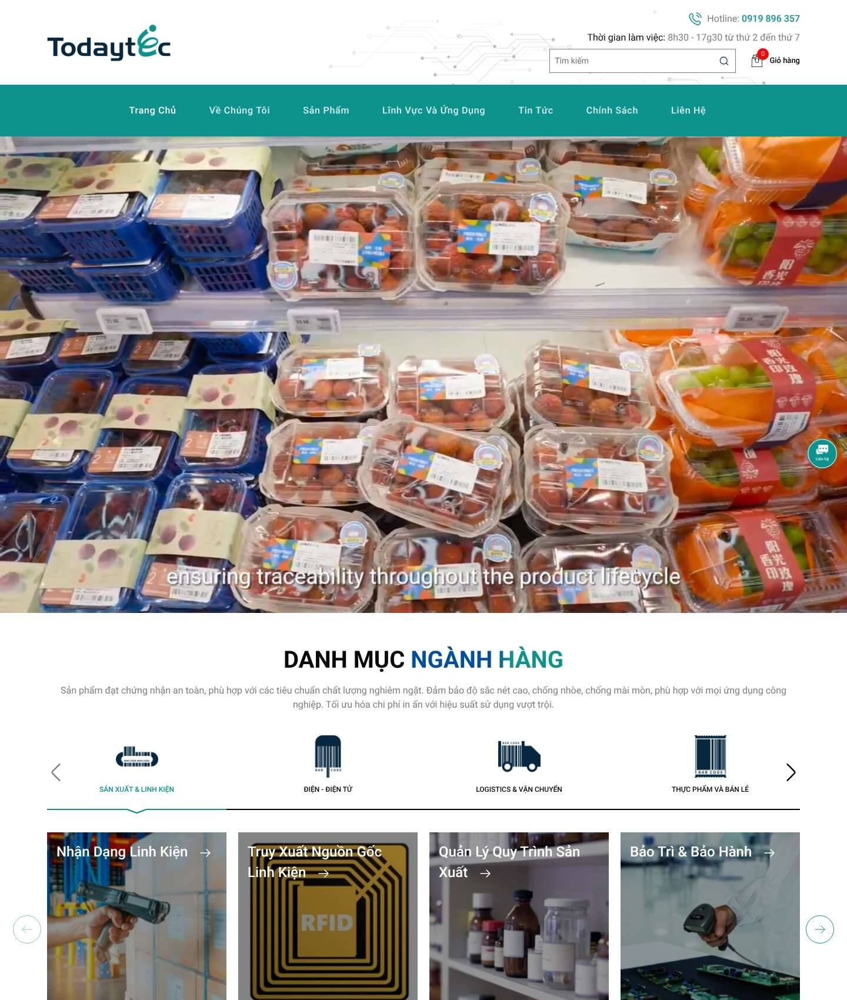 | 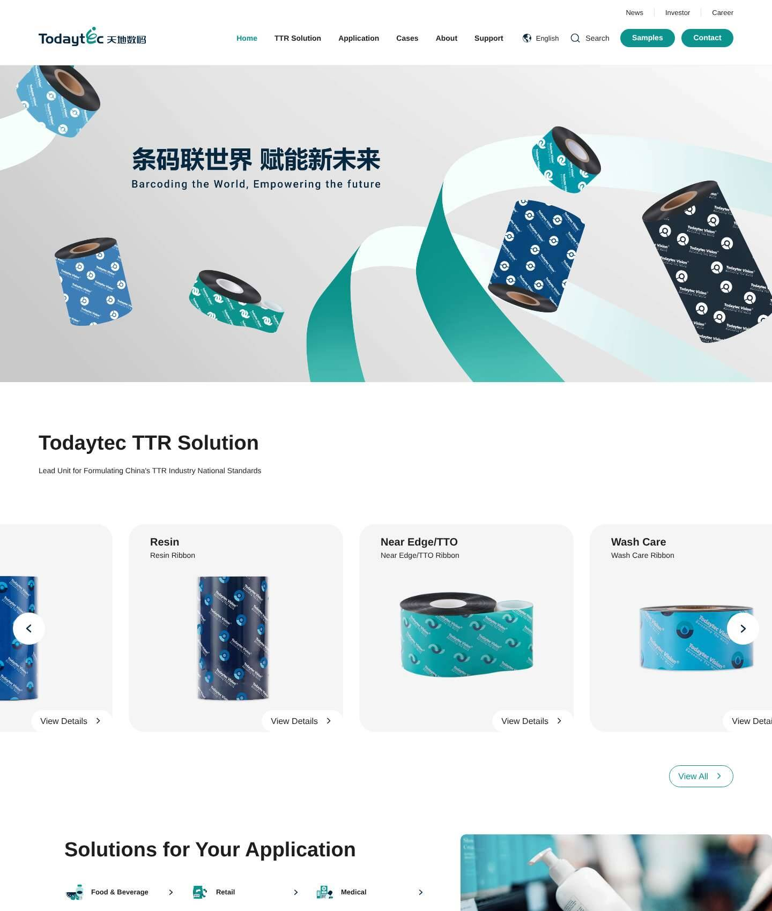 |
| Collection / series | 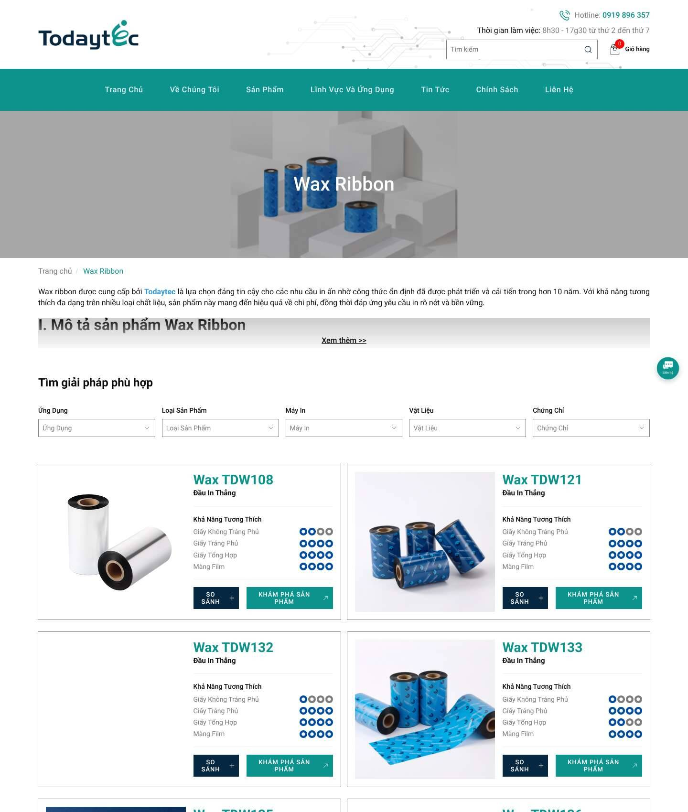 | 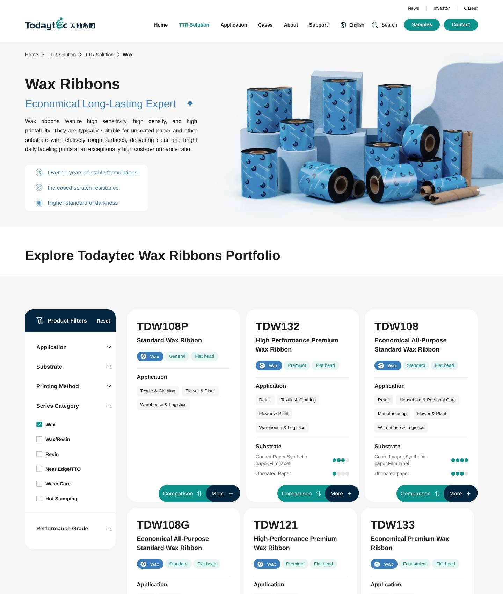 |
| Product | 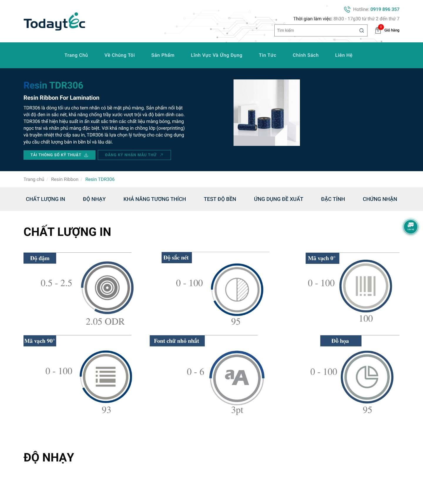 | 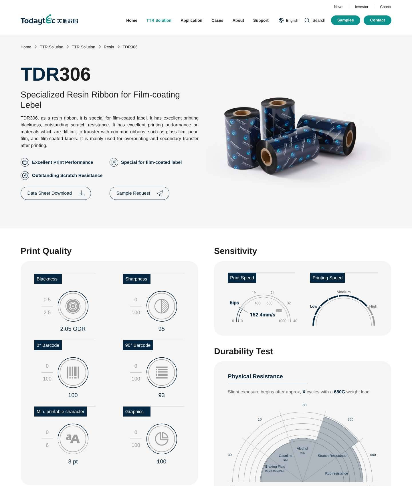 |
| Article | 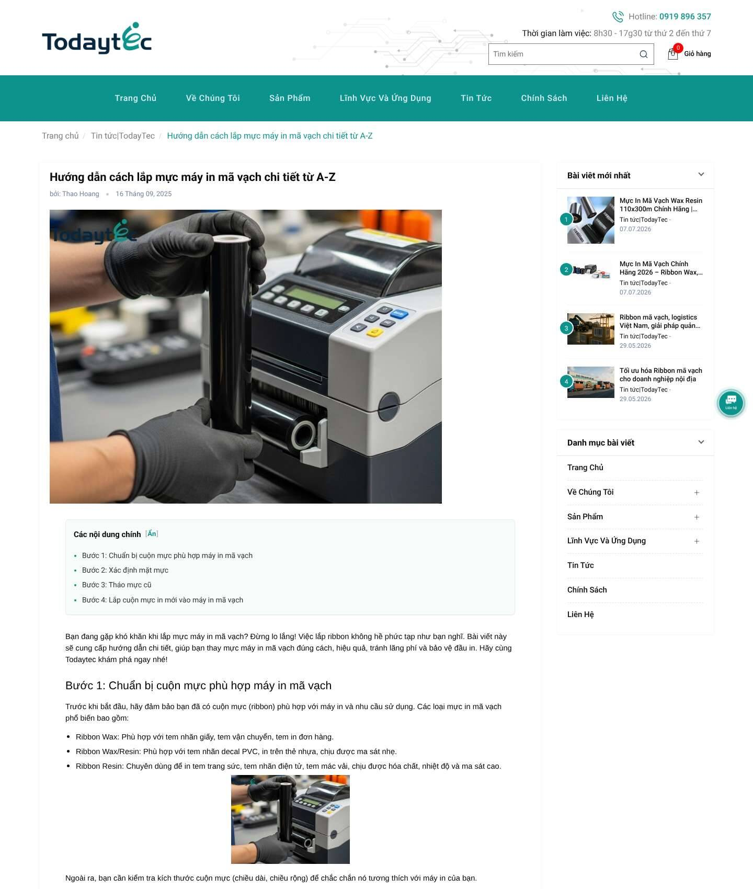 | 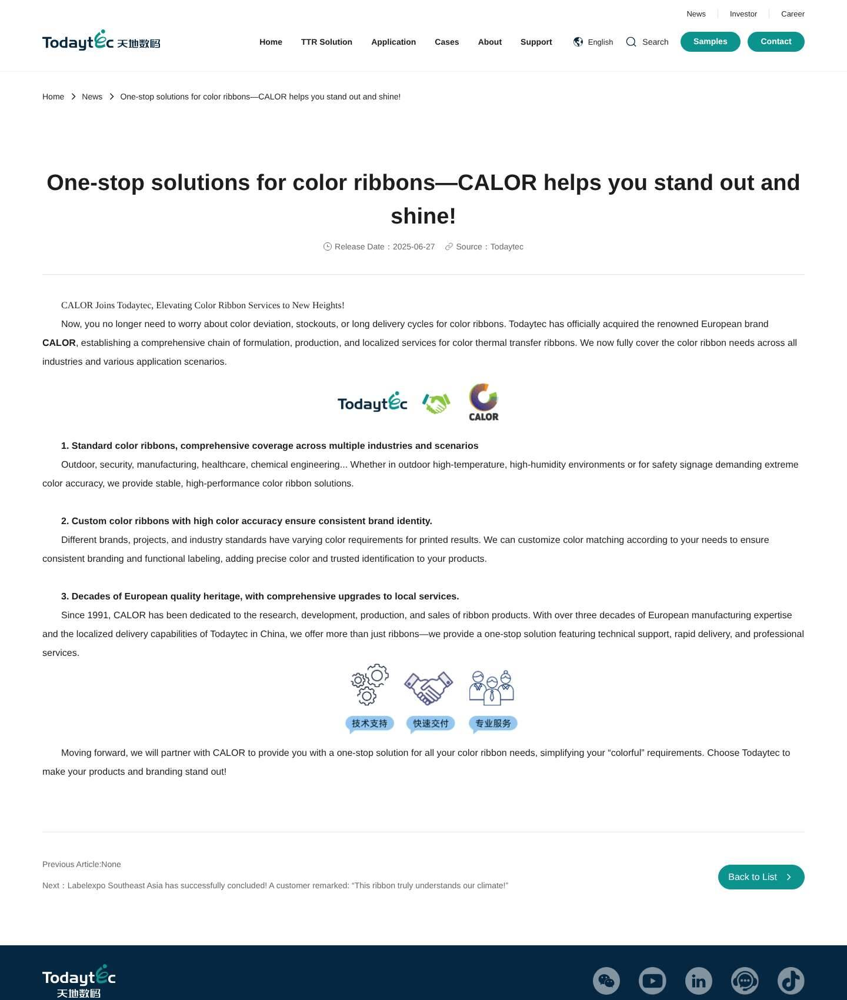 |

| Page | todaytec.com.vn mobile | todaytec.com mobile |
|---|---|---|
| Home | 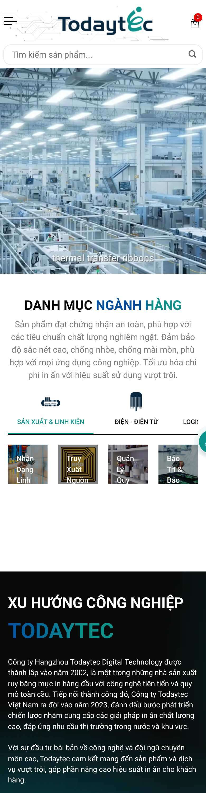 | 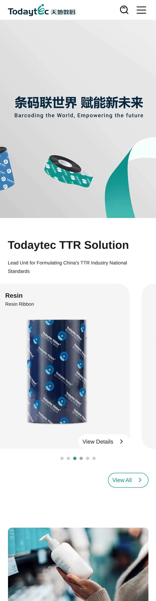 |
| Collection | 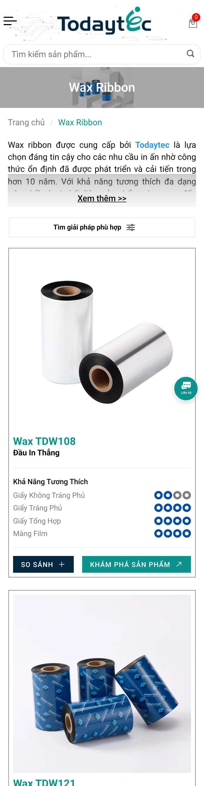 | 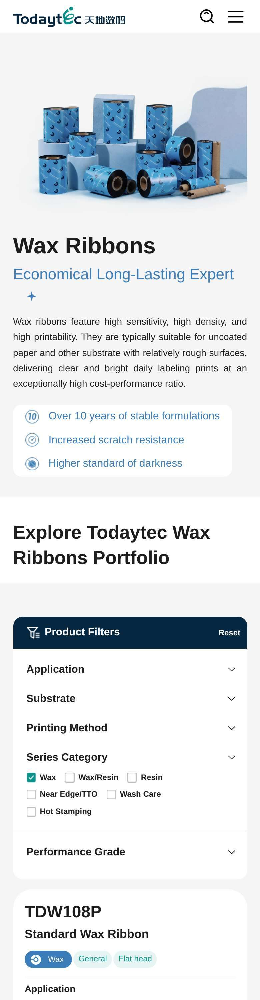 |
| Product | 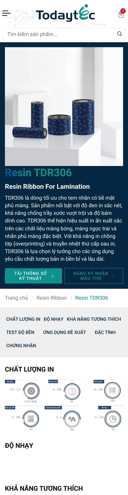 | 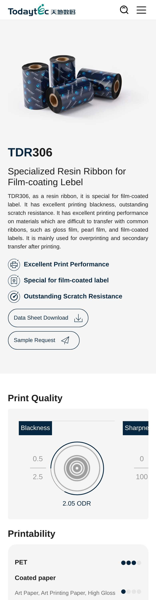 |
| Article | 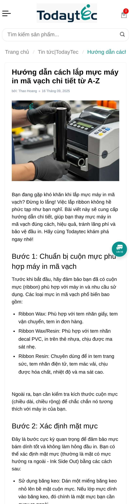 | 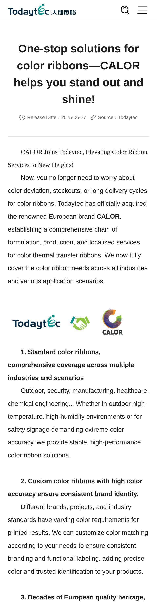 |

What PageSpeed and Lighthouse see on VN (finding D2): 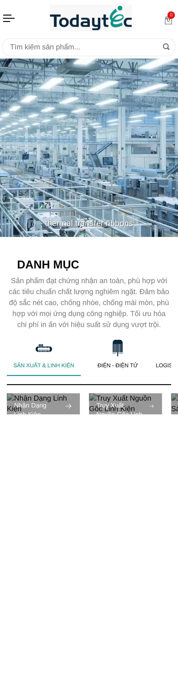

The .com shots were taken with a tall viewport after a scroll pass. In a full-page capture its WOW.js blocks stayed blank, which shows how much of .com depends on animation scripts.

### Deviations

| Rule | todaytec.com.vn | todaytec.com |
|---|---|---|
| **Primary colours** | ✓ Teal nav bar (`rgb(12,147,142)`), navy buttons and product hero (`#062741`), footer `#efefef`, body text `#090909`. | ✓ Teal CTAs (188 CSS hits), navy (55). |
| **No gradients or recolouring** | ✗ 22 gradient-text rules `linear-gradient(90deg, #004EA2 …, #0C938E …)` on the product H1 (`.product-heading h1`), "DANH MỤC **NGÀNH HÀNG**", "TODAYTEC", the about and blog headings. `#004EA2` is off-palette (closest: Wax/Resin `#004e82`). | ✓ No gradient text (9 decorative gradients). |
| **Functional series colours** | ✗ 0 uses. Rating dots and links use other blues (`#3498db`, `#1a73e8`). | ✓ Wax series in `#3c7ebb` (19); near-variants `#3c7eb1`, `#3c7db3`, `#5ba4cc`, `#004e80` should be snapped to the exact hex values. |
| **Off-palette accents** | ✗ Red `#ff0000` / `#e70505` (46 rules: cart and coupon badges), green `#3d9851` (8). | Minor (`#7ab51c` ×3). |
| **Contrast (small text)** | ✗ White 16 px nav labels on teal give 3.76:1; teal small text (442 characters on home); `#7d7d7d` text gives 4.12:1. | ✗ White 14 px bold "Samples"/"Contact" on teal give 3.76:1. |
| **Typography** | ✓ Roboto 400/500/700 (`fonts.googleapis.com/css?family=Roboto:300,400,500,700`), loaded twice. ✗ Article body in Arial (inline editor styles). ✗ Spec gauges are images in a serif face. | ✗ Computed `font-family: Arial, Helvetica, sans-serif, "Microsoft Yahei"`; no web font loaded on home or product. |
| **Logo version and size** | ✓ Standard colour wordmark `logo.png`, 210×67 px desktop and 180×58 mobile (≥72 px). Raster PNG, not SVG. | ✓ SVG 200×36. ✗ for VN use: the Chinese/English lockup "Todaytec 天地数码" is for China business (VI p. 12). |
| **Logo placement / clear space** | Top-left (web convention; see below). ✗ The mobile and desktop header draws a circuit-board line illustration behind and next to the logo, inside its clear space. ✗ Article hero images have the logo stamped top-left on a busy photo (e.g. `cach-lap-muc-may-in-ma-vach`). | Top-left with clean white space ✓. |
| **Graphic element** | ✗ The "e" ribbon pattern and series badges are not used. The decorative language is circuit lines and generic industry icons. | ✓ Teal ribbon swooshes, series-badge icons on the chips, product rolls printed with the badge pattern. |
| **Ratio 60/30/10** | Home is roughly white or neutral, with teal concentrated in the nav and video. Acceptable, but navy is under-used (bg area: teal 129k px², navy 5.7k px²). | Close to the guide: white/grey, navy panels, teal accents. |

**Logo position.** VI p. 14 places the logo top-right for **page layouts** such as print, decks and KVs. Both websites use the web-standard top-left header logo. Our recommendation:
- Keep top-left in the site header.
- Apply the VI rule to **banners, KV images and `og:image` share cards**, with the logo top-right on a solid field.
- Design should confirm this with HQ brand.

---

## 9. Prioritised fix plan

- **Owner roles:** Dev (Haravan theme developer), SEO, Content, Design.
- **Effort:** S ≤ 1 day · M 2–5 days · L > 1 week.
- **File paths** are Haravan theme files. Template names were seen in the source; snippet names are guesses until we have theme access (§12).
- **Update 30/10:** `layout/theme.liquid` and `templates/index.liquid` were reviewed from the real code. §13 gives the exact locations for rows #2, #5, #7, #9a, #10, #11, #13 and #14, plus a ready-to-paste layout. It also adds a new item: the Meta Pixel is installed twice (T2).

| # | Pri | Issue | Evidence | Fix (Haravan location) | Owner | Effort | Expected impact | Month |
|---|---|---|---|---|---|---|---|---|
| 1 | P0 | Migration 301s missing | A1, A2, §4 | Use Haravan's **URL redirect** feature in admin (the exact menu label must be confirmed) to add one-hop 301s for the proposed map below. Then re-check every row with a crawler and the GSC URL Inspection tool, and validate "Not found (404)" in GSC. No theme change is needed. | SEO + Dev | S | Recovers link equity for 4 of the 7 lost keywords. The four old series URLs drew 19.2k impressions since Jul 2025. | T11 wk1 |
| 2 | P0 | Lead conversion fires on page load | E1 | Remove `gtag('event','conversion_event_submit_lead_form')` from `layout/theme.liquid` `<head>`. Fire it only on a successful contact or quote form submit (in the form's JS callback, `templates/page.contact.liquid` and the footer form snippet). Review `ads_conversion_Contact_Page_load_today_1`. In Google Ads, mark the old conversion secondary until the data is clean. | Dev + SEO | S | Trustworthy lead KPIs and Ads bidding. | T11 wk1 |
| 3 | P0 | 20.7 MB hero video | D1 | `templates/index.liquid` (home slider or video section): one `<video>` only, `preload="none"`, poster-first. Re-encode at ≤ 2 MB (720p, H.264 plus WebM). On mobile, show the poster image only (no autoplay). | Dev + Design | S | −20 MB per desktop home visit. LCP and bandwidth improve. | T11 wk1 |
| 4 | P0 | Lighthouse-cloaking script | D2 | Check GSC URL Inspection → "View tested page" (screenshot and HTML) for `/` and one collection. Then remove the `f1genzPS` gate and `optimize_async.js` / `nosrc` swapping from `layout/theme.liquid` (head "SCRIPT THEME" block), replacing it with honest `defer` or `async`. Ask the theme vendor where the code came from. | Dev | S–M | A real performance baseline; removes the rendering risk for Googlebot. | T11 wk1–2 |
| 5 | P1 | Junk URLs indexable | A3, A4 | **Content:** delete `/blogs/news/bai-viet-mau` (301 → `/pages/about-us`); delete or hide `/pages/frontpage`; replace the Lorem ipsum in the blog SEO description. **Theme (`layout/theme.liquid` head):** output `<meta name="robots" content="noindex,follow">` when the template is search, the collection handle is `all`, `frontpage`, `onsale` or `hot-products`, the URL is `/collections/types`, or the blog view is filtered by tag (pseudo-Liquid; check variable names against the Haravan theme). Keep the pages working for users. | SEO + Dev + Content | S | Less index bloat and cannibalisation (the "ribbon resin" case). | T11 wk2 |
| 6 | P1 | Duplicate about pages | A5 | T11: `rel=canonical` from `/pages/gioi-thieu` to `/pages/about-us`, set by a page-handle condition in `layout/theme.liquid`. No redirect yet. T12: decide whether to 301. | SEO + Dev | S | Consolidates 2,971 impressions. | T11 |
| 7 | P1 | Home H1 hidden | B1 | Header snippet (logo block in `layout/theme.liquid` or `snippets/header*.liquid`): change `<h1 style="display:none">` to `<div>`. Add a visible H1 in `templates/index.liquid`, e.g. "Mực in mã vạch – Ruy băng in mã vạch chính hãng Todaytec". Shorten the meta description to ≤160 characters. | Dev + Content | S | Clearer relevance on the strongest URL. | T11 |
| 8 | P1 | Weak or auto-cut metadata | B2, B3 | Use the per-item SEO title and description fields in Haravan admin (Collections, Products) for: Wash Care (add "ribbon in nhãn mác quần áo / tem giặt"), TTO (align the H1 to "Ribbon TTO / Near-Edge"), Hot Stamping, and all 32 products ("TDR306 – Ribbon Resin cho tem phủ màng \| Todaytec"). Fix the "Mô tả sản phẩm dành cho sản phẩm…" prefix. | Content + SEO | M | CTR and relevance for the lost keywords. | T11 |
| 9 | P1 | Structured data | C1–C4 | Add JSON-LD:<br>(a) `Organization` and `LocalBusiness` (name "Công ty TNHH Todaytec Vietnam", address "Số 199 Hồ Học Lãm…", telephone, `sameAs` Facebook, LinkedIn, YouTube and Zalo, `parentOrganization` Hangzhou Todaytec) in `layout/theme.liquid`.<br>(b) `BreadcrumbList` in the breadcrumb snippet.<br>(c) `Product` in `templates/product.liquid`: `sku`, `brand` as Brand, `description`, `image`, `additionalProperty` for specs. **Drop `offers` while the price is 0**, or publish a real price.<br>(d) `BlogPosting` in `templates/article.liquid` (author, `datePublished`, `dateModified`, image, publisher).<br>Remove the head-placed Product microdata. | Dev + SEO | M | Eligibility for breadcrumb rich results and a valid product entity; stops the 0₫ price. | T11 |
| 10 | P1 | Internal links to new collections | B5, §4 | Edit the top posts (`ruy-bang-muc-in-ma-vach-la-gi` 5.3k impressions, `may-in-ma-vach-khong-ra-muc` 3.1k, `cach-lap-muc-may-in-ma-vach` 2.9k, `muc-in-tto` 2.4k, `tem-nhan-van-don` 2.4k) to link with exact anchors to the new series URLs. Add a "Featured SKUs" block with `/products/` links on the home page. Replace `?view=vi` links with clean URLs (home blog block). | Content + Dev | S–M | Faster consolidation of the new URLs. | T11 |
| 11 | P1 | HTML bloat | D3 | In `layout/theme.liquid`, the "CSS THEME" and "JS THEME" blocks print Bootstrap, Swiper, Soon, Popper and jQuery inline. Move them to `assets/` files loaded with `<link>` or `<script defer>`, drop the duplicate jQuery, and drop Soon and Popper if unused. Inline only critical CSS (about 15 KB). | Dev | M | Home HTML from 914 KB to ≤ 150 KB; better FCP and LCP on every page. | T11 wk3–4 (or in the T12 rebuild) |
| 12 | P1 | Collection CLS / mobile overflow | D4, D5 | `templates/collection.liquid` plus theme CSS: reserve the banner and card image sizes (`width`, `height`, `aspect-ratio`). Fix the element wider than 390 px on home (find it in DevTools). | Dev | S | CLS from 0.238/0.532 to < 0.1. | T11 |
| 13 | P2 | Pagination canonical | A7 | Canonical tag in `layout/theme.liquid` ("SEO PAGI" block): make `?page=N` self-canonical. | Dev | S | Crawl paths to the deeper SKUs. | T11 |
| 14 | P2 | 404 template | A8 | `templates/404.liquid` and the head: no canonical, `og:url` or hreflang output on 404. Add search, the 6 series links and a hotline. | Dev | S | Clean error handling. | T11 |
| 15 | P2 | Alt text, images | B6, B7 | Rating dots → `alt=""` (in `templates/collection.liquid` product-loop snippet). Fill content alts. Re-export product PNGs as WebP or JPG ≤ 150 KB with width and height. | Content + Dev | S–M | Accessibility, weight. | T11–T12 |
| 16 | P2 | Third-party weight | D6 | Load reCAPTCHA on form focus; one Roboto request; replace FontAwesome 4 with inline SVG icons; keep a single GA4 source (E2). | Dev | S | −0.5 MB per page. | T12 |
| 17 | P2 | TikTok / Ads measurement | E3 | Confirm in TikTok Events Manager whether a pixel exists. If campaigns run, install it through the Haravan integration and verify events. | SEO | S | Measured TikTok traffic. | T11 |
| 18 | P1 | Brand: gradients, off-palette colours, contrast | F1–F3 | In the T12 theme CSS (`assets/style-themes.scss.css`): remove the `background-clip:text` gradients, replace `#004EA2` with `#062741`, use `#0A827E` for small teal text and white-on-teal, use series colours for chips and badges, and limit red to error states. | Design + Dev | M | VI compliance, AA contrast. | T12 |
| 19 | P1 | Product template rebuild | D/§6 | `templates/product.liquid`: specs as HTML text (blackness ODR, sharpness, 0°/90° barcode, min. character, speed ips/mm/s, durability, PET thickness, ink melt point, storage, certifications), a same-series compare table, and datasheet, sample and quote CTAs. Data from product metafields or the description template. | Dev + Content + Design | L | Crawlable specs, better B2B UX, richer Product schema. | T12 |
| 20 | P1 | IA and template look to match .com | §6 | Duplicated, unpublished theme: header (logo, Sản phẩm › 6 series, Ứng dụng › industries, Case study, Hỗ trợ & tải tài liệu, Tin tức, persistent "Nhận mẫu" and "Báo giá" buttons plus hotline and Zalo); `templates/collection.liquid` with a series hero in the functional colour plus badge, filter sidebar and chips; `templates/article.liquid` in Roboto, without the logo stamped on photos. **Keep every handle.** | Design + Dev | L | Brand consistency, conversion. | T12 |
| 21 | P2 | hreflang to .com | A11 | Optional. Only if HQ adds the reciprocal tags on .com. Hard-code `<link rel="alternate" hreflang="en">` on matching product URLs in `templates/product.liquid` (Haravan has no Shopify-Markets-style automation that we know of). | SEO + HQ | M | Low. | T12 or later |

**Proposed 301 map** (rows marked ✓ were status-checked as 404 on 30/10; the others need checking before import):

| From (GSC 2026 impressions) | To |
|---|---|
| ✓ `/collections/wax-ribbon` (3,705) · ✓ `/collections/wax-ribbon-1` (622) · `/collections/wax` (10) | `/collections/muc-in-ma-vach-wax` |
| ✓ `/collections/resin-ribbon` (3,328) · `/collections/resin-ribbon-en` | `/collections/muc-in-ma-vach-resin` |
| ✓ `/collections/wax-resin-ribbon` (1,856) · `/collections/wax-resin-ribbon-en` (14) · `/collections/wax-resin` (14) | `/collections/muc-in-ma-vach-wax-resin` |
| ✓ `/collections/wash-care-ribbon` (1,252) · ✓ `/collections/wash-care-ribbon-en` (53) · `/collections/wash-care` | `/collections/muc-in-ma-vach-wash-care` |
| ✓ `/collections/ribbon-dap-nhiet-tto-wax-resin-ribbon` (546) · `/collections/near-edge-tto-ribbon-1` (31) · `/collections/near-edge` (8) | `/collections/muc-in-ma-vach-dap-nhiet-tto-wax-resin` |
| ✓ `/collections/hot-stamping-foil-1` (567) · `/collections/hot-stamping-foil-2` | `/collections/hot-stamping-foil` |
| ✓ `/pages/about-todaytec` (1,476) · `/pages/todaytec` (13) · `/blogs/news-todaytec/about-todaytec` (40) | `/pages/about-us` |
| ✓ `/pages/product-range-comparison` (176) | `/pages/so-sanh-san-pham` |
| `/pages/contact-todaytec-ready-to-support-all-your-requests` (50) | `/pages/lien-he` |
| `/pages/barcode-ink-applications-in-pharmaceuticals-chemicals-ensuring-safety-and-efficiency-with-todaytec` (161), plus the same with `-1` | `/pages/ung-dung-muc-in-ma-vach-trong-nganh-duoc-pham-hoa-chat-dam-bao-an-toan-va-hieu-qua-voi-todaytec` |
| `/pages/label-applications-in-the-electronics-electrical-industry` (72) | `/pages/ung-dung-cua-nhan-trong-nganh-dien-dien-tu` |
| `/pages/label-applications-in-the-garment-industry` (59) | `/pages/ung-dung-cua-nhan-trong-nganh-may-mac` |
| `/pages/label-applications-in-warehouse-management-and-transportation` (46) | `/pages/ung-dung-cua-nhan-trong-nganh-kho-va-van-chuyen` |
| `/pages/label-applications-in-retail-enhance-product-value-and-customer-experience` (45) | `/pages/ung-dung-cua-nhan-trong-nganh-ban-le` |
| `/pages/durable-labeling-solutions-for-the-agriculture-plantation-industry` (51) | `/pages/giai-phap-nhan-in-toi-uu-cho-nganh-nong-nghiep-cay-trong` |
| `/pages/todaytec-s-thermal-transfer-ribbon-applications-in-the-automotive-industrial-sector` (23) | `/pages/toi-uu-hoa-giai-phap-ghi-nhan-nganh-cong-nghiep-o-to-cung-todaytec` |
| `/pages/labeling-applications-in-the-manufacturing-components-industry` (6) | `/pages/ung-dung-nhan-va-giai-phap-ribbon-cho-nganh-san-xuat-linh-kien` |
| `/pages/applications-todaytec` (7) | `/pages/ung-dung-nganh-hang` |
| ✓ `/blogs/news/ruy-bang-muc-in-ma-vach-la-gi-vi-sao-phai-chon-dung-todayte` (1,139) | `/blogs/news/ruy-bang-muc-in-ma-vach-la-gi` |
| ✓ `/blogs/news-todaytec/barcode-ribbon-for-the-electronics-component-industry-the-optimal-al` (697) | `/blogs/news/muc-in-ma-vach-cho-nganh-linh-kien-dien-tu-giai-phap-thay-the-toi-uu` |
| ✓ `/blogs/news-todaytec/common-thermal-transfer-ribbon-issues-and-how-to-fix-them` (509) | `/blogs/news/nhung-van-de-thuong-gap-o-ribbon-muc-in-ma-vach-va-cach-khac-phuc` |
| `/blogs/news-todaytec/industrial-labels-printing-ribbons-the-key-to-enhancing-efficiency` (77) | `/blogs/news/tem-nhan-ruy-bang-muc-in-cong-nghiep-chia-khoa-nang-cao-hieu-qua-ch` |
| `/blogs/news-todaytec/todaytec-durable-premium-label-printing-solutions-for-the-garment` (48) | `/blogs/news/todaytec-giai-phap-in-nhan-mac-ben-dep-cho-nganh-may-mac-da-giay` |
| ✓ `/products/wash-care-tdr380-1` (183) | `/products/wash-care-tdr380` |
| `/products/wax-resin-tdm242` (126) · `/products/wax-resin-tdm240` (85) · `/products/wax-resin-tdm240p` (16) · `/products/tdm230` (71) · `/products/wax-resin-tdm230` (18) · `/products/tdm238` (45) · `/products/wax-resin-tdm669-1` (30) · `/products/wax-resin-t209` (12) | `/products/wax-resin-ribbon-tdm242` · `/products/tdm240` · `/products/tdm240p` · `/products/wax-resin-tdm230-2` · `/products/wax-resin-tdm230-2` · `/products/wax-resin-tdm238-2` · `/products/wax-resin-tdm669` · `/products/wax-resin-ribbon-t209` |
| `/products/resin-tdr320-1` (76) · `/products/resin-tdr330-1` (39) · `/products/resin-tdr347w-1` (28) · `/products/resin-tdr325` (17) · `/products/resin-tdr345` (9) · `/products/resin-tdr346w` (9) | `/products/resin-tdr320` · `/products/resin-tdr330` · `/products/resin-tdr347w` · `/products/resin-ribbon-tdr325` · `/products/resin-ribbon-tdr345` · `/products/resin-ribbon-tdr346w` |
| `/products/wax-tdw132` (35) · `/products/wax-tdw133` (24) · `/products/tdw108` (17) · `/products/wax-tdw108` (5) · `/products/wax-tdw136` (14) · `/products/wax-tdw121` (12) · `/products/wax-ribbon-tdw135-2` (13) | `/products/tdw132` · `/products/tdw133` · `/products/wax-tdw108-2` · `/products/wax-tdw108-2` · `/products/tdw136` · `/products/tdw121` · `/products/wax-ribbon-tdw135-1` |
| `/products/hot-stamping-foil-dmp901-1` (47) · `/products/hot-stamping-foil-dmp988a` (36) · `/products/wash-care-tdr385r-1` (17) | `/products/hot-stamping-foil-dmp901` · `/products/hot-stamping-foil-dmp988a-1` · `/products/wash-care-tdr385r` |
| `/products/hot-stamping-foil-t910`, `wax-resin-tdm342`, `wax-resin-tdm665`, `wash-care-t383`, `resin-t352`, `resin-t303` (5–15 each) | No current SKU in the sitemap: send each to its series collection (confirm with the product team) |
| `/blogs/default-handle/*` (6 URLs, 8–98), `/pages/default-handle-4`, `/pages/default-handle-9`, `/pages/en-landing-page-02` | Unknown origin: check the content, then point each to its closest page or `/blogs/news` |

---

## 10. Recommendation: "Chỉnh theo todaytec.com trong T11 & T12 thì sao?"

**Recommendation: adopt .com's look, information architecture and product template in T12. Do not adopt its URLs or SEO patterns. Spend T11 on technical fixes with zero new URL changes.**

### Pros of aligning to .com
- One brand experience across Todaytec sites (series colours, badges, ribbon visuals).
- .com's product template shows spec values as text, which is crawlable and helps B2B buyers compare.
- A proven B2B IA: applications by industry, cases, downloads, and persistent sample and contact CTAs.
- .com's lean front end (16 KB HTML, 138 KB JS) is the right target for the VN rebuild.

### Cons and risks

| Risk | Why it matters | Mitigation |
|---|---|---|
| **A second URL wave right after the Sep/Oct migration** | The 301s are still missing (A1). Google has not yet consolidated the new series URLs: Oct showed 277 impressions at position 17.6. Changing handles again would reset this a second time. | **Freeze all handles until at least end of Q1 2027.** Template and visual changes only. Redirect map unchanged. |
| Copying .com's SEO weaknesses | §6 and §7: no canonical tags, duplicate titles, soft 404, missing H1s | Use the QA checklist below. Build the theme from the VN technical base, not from .com code. |
| Haravan constraints | `/products/{handle}` is fixed. Filters can create indexable parameter URLs. Some features are unconfirmed (§11). | Keep filters client-side or on noindexed URLs. Confirm the platform features with Haravan before building. |
| Capacity and the year-end freeze | December leaves little time for QA. | Publish only when QA passes. If it isn't green by 15 Dec, move publishing to the week of 5 Jan 2027. |
| Content dependency | The specs exist on .com in English, but the VN product data must be in Vietnamese. | Content team translates the TDS fields in T11, in parallel. |
| Measurement noise | E1 inflates conversions, so before/after comparisons are invalid until it is fixed. | Fix E1 in T11 wk1 and take a clean 3-week baseline before the T12 launch. |

### Phased plan

**T11 (Nov): technical quick wins, no new URLs**

| Task | Owner | Effort | KPI |
|---|---|---|---|
| Restore the 301 map (§9) and check each row | SEO + Dev | S | 0 GSC-seen URLs returning 404; each old URL 301s in one hop |
| Fix the lead conversion firing (E1) and the GA4 duplicate (E2) | Dev | S | Lead events equal real submits (spot-check 10) |
| Hero video ≤ 2 MB, single element, poster on mobile | Dev + Design | S | Home desktop transfer ≤ 3 MB (from 23.1 MB) |
| Remove the f1genz cloak; check Googlebot rendering | Dev | S–M | URL Inspection screenshot is correct; lab results the same for all profiles |
| noindex the junk listings; delete the sample and placeholder pages; fix the Lorem ipsum | SEO + Content + Dev | S | Junk-URL impressions → 0 by end Dec |
| Home H1, metadata for Wash Care, TTO, Hot Stamping and the 32 products | Content + SEO | M | 100 % of key pages with unique titles of 50–65 characters and descriptions ≤ 160 |
| JSON-LD: Organization, LocalBusiness, Breadcrumb, Product (no 0₫), BlogPosting | Dev + SEO | M | 0 errors in the Rich Results Test; valid Breadcrumb report in GSC |
| Internal links from the top 5 posts to the new collections | Content | S | New series URLs: impressions ≥ 536/month (Aug baseline of the old URLs) |
| De-inline libraries; fix collection CLS and mobile overflow | Dev | M | HTML ≤ 150 KB; CLS < 0.1 |

**T12 (Dec): rebuild the look on a duplicate theme, then publish after QA**

| Task | Owner | Effort | KPI |
|---|---|---|---|
| Duplicate the live theme as an unpublished copy; build the header and IA (series, applications, cases, downloads; Nhận mẫu, Báo giá, hotline, Zalo) | Design + Dev | L | Every handle unchanged (diff of crawl before and after = 0 URL changes) |
| Collection template in series colours and badges, with filters and chips (VI p. 26 and 45) | Design + Dev | M | 0 off-palette colours; contrast AA |
| Product template with specs as text, compare, datasheet and sample | Dev + Content | L | 32/32 SKUs with text specs; Product schema with `additionalProperty` |
| Article template: Roboto, no logo on photos, BlogPosting | Dev + Design | S | 100 % of text in Roboto |
| Performance budget | Dev | M | Lab LCP ≤ 2.5 s desktop / ≤ 4.0 s Slow-4G mobile; CLS ≤ 0.1; JS ≤ 300 KB |
| QA, publish, monitor for 72 h | SEO + Dev | M | No rise in 404s or 5xx; leads within ±20 % week on week |

### QA checklist before publishing the T12 theme
1. **URLs:** a crawl of the live theme and the preview theme gives the same list of 200 URLs. Every row of the redirect map still 301s in one hop.
2. **Canonical:** self-canonical on collection, product, article and page. `/collections/x/products/y` → `/products/y`. `?page=N` is self-canonical. `?sort_by` and `?view` → clean URL. No canonical on 404.
3. **Indexing:** `noindex,follow` on the junk set (A3) and on search, tag and `types` pages. No `noindex` on any money page.
4. **Metadata:** one H1 per page. Titles and descriptions are carried over byte for byte from T11.
5. **Structured data:** Rich Results Test passes on 1 page per template. No `price 0`.
6. **CWV budget:** HTML ≤ 150 KB, JS ≤ 300 KB, no autoplay video over 2 MB, LCP and CLS targets as above, measured with the iPhone profile **and** the Lighthouse profile (they must match).
7. **Tracking:** GA4 `page_view` once. Lead conversion only on submit. Zalo and tel click events.
8. **Brand:** palette tokens only (`#062741`, `#0c938e`, neutrals, the 6 functional colours, `#0A827E` for small teal text). Roboto everywhere. Logo clear space. No gradients.
9. **Mobile:** no horizontal overflow at 360 and 390 px. Tap targets ≥ 44 px. CTAs visible.

### KPIs to judge success
**Baselines (GSC):** Oct 1–27 2026 site 166 clicks, 7,214 impressions, position 8.2; new series collections 277 impressions, position 17.6.

| KPI | By end Dec 2026 | By end Feb 2027 |
|---|---|---|
| GSC-seen URLs (≥5 impressions) returning 404 | 0 | 0 |
| New series collections, impressions per month | ≥ 536 (old-URL Aug level) | ≥ 1,000 |
| New series collections, average position | ≤ 12 | ≤ 8 |
| The 7 tracked keywords in the rank check | All in top 50; ≥ 3 in top 20 | ≥ 3 in top 10 |
| Home transfer (desktop) | ≤ 3 MB | ≤ 2 MB |
| Collection CLS | < 0.1 | < 0.1 |
| Junk URLs with impressions | ≤ 2 | 0 |
| Lead conversions | Equal to real submits (audited) | – |
| Rich results | Breadcrumb and Product valid | – |

### Rollback plan
- **Before publishing:**
  - Keep the current live theme ("New multilanguage", id 1001476833) **unpublished but intact**. `Haravan.theme.role` shows Haravan distinguishes main and other themes; confirm preview and re-publish in admin.
  - Save a copy of the theme files.
  - Export the redirect list.
  - Record a crawl snapshot and GA4 and GSC baselines.
- **Redirects and SEO fields are stored in admin**, not in the theme. A theme rollback does not touch them.
- **Triggers for rolling back within 72 h:**
  - 5xx errors, or any spike in 404s.
  - Leads down more than 30 % week on week.
  - Lab LCP worse than before.
  - A GSC coverage error spike.
  - A broken checkout or contact form.
- **How:** re-publish the old theme (minutes), re-run the QA crawl, and log the cause before trying again.

---

## 11. Haravan SEO controls: confirmed vs unconfirmed

| Control | Status | Evidence / note |
|---|---|---|
| Theme identification | **Confirmed** | `Haravan.theme = {"name":"New multilanguage","id":1001476833,"role":"main"}`; assets `cdn.hstatic.net/themes/200000930815/1001476833/14/`; templates `index`, `collection`, `product`, `article`, `article.vi`, `blog`, `blog.en`, `page`, `page.about-us`, `page.contact`, `404` (from `template-*` and `multi_template`) |
| Liquid theme with `layout/`, `templates/`, `snippets/`, `assets/` and alternate templates via `?view=` | **Confirmed** (as rendered) | `?view=vi` → `multi_template = "article.vi"`; HTML comments "SEO META DESCRIPTION", "SEO PAGI", "CSS THEME", "JS THEME" mark head blocks |
| robots.txt | Platform-generated: **confirmed**. Editable: **unconfirmed** | Shopify's `robots.txt.liquid` must not be assumed. Use `meta robots` in the theme, which works either way. |
| Sitemap | Auto-generated index (products, blogs, pages, collections): **confirmed** | The sitemap comment says it "can not be edited manually". Excluding an object without unpublishing it is **unconfirmed**. |
| Canonical | **Theme-controlled**: confirmed, since the behaviour changes per template and breaks on 404 | Fixed in `layout/theme.liquid` |
| Per-item SEO title, description and handle in admin | Likely; **check in admin** | Custom titles and descriptions exist on key pages, so a field exists. The 320-character auto-cuts show what happens when it is empty. |
| URL redirects (301) in admin, plus bulk import | **Unconfirmed**: menu label, limits, CSV import | Needed for fix #1. Ask Haravan support if not visible. |
| Duplicate, preview and publish themes | Likely (`role: "main"` implies other roles); **check** | Required for T12 |
| Theme export (download) | **Unconfirmed** | Shopify's "Download theme file" email flow must not be assumed. Fallback: a staff account with theme-code access. |
| hreflang automation | **None that we know of** (no Shopify-Markets equivalent seen) | Hard-code it in the theme if needed |
| Apps and scripts on the storefront | **Observed:** HaravanAnalytics (GA4 `G-M1ES2Z5T5J`, Meta Pixel `31050256297898923`, `enhancedEcommercev4`, `AutoTrack`), Haravan beacon (`stats.hstatic.net/beacon.min.js`), `cdn.hstatic.net/shared/api.jquery.js` (cart API), reCAPTCHA v3, LinkedIn Insight `8624865`, lazysizes 5.2.1 (cdnjs), f1genz `optimize_async.js`. **Not observed:** Harasocial, TikTok pixel, Google Ads `AW-` tag. | Admin (per Boss's screenshot): **TikTok Ads and Google Ads connected under Marketing**. On the storefront only GA4-linked Google conversion pings were seen (E1). |

---

## 12. What Boss needs to provide

1. **A Haravan staff account**, not Shopify, with permissions for Website/Themes (code edit, duplicate, publish), Products, Collections, Pages, Blog, URL redirects, Apps and Marketing integrations. Or, if Haravan offers it, an **export of the live theme "New multilanguage" (id 1001476833)** for a file-level Liquid audit.
2. **GSC access** (Full user or Owner) for `todaytec.com.vn`: URL Inspection (to check the f1genz rendering), validating 404 fixes, resubmitting the sitemap.
3. **GA4 (`G-M1ES2Z5T5J`) and Google Ads access**, to fix and re-classify the lead conversion; **TikTok Ads and Events Manager** access, to confirm the pixel.
4. **The redirect list used in Sep/Oct**, and the actual migration date (GSC suggests 10–20 Sep).
5. **Theme vendor contact**, for the origin of the `f1genz` / `optimize_async.js` code.
6. **Product data:** TDS/MSDS for the 32 SKUs (Excel or PDF from HQ), permission to reuse .com product photography and spec visuals, and the brand SVG assets (logo, series badges, "e" pattern).
7. **A pricing decision:** publish indicative prices (enables Offer markup) or stay "Liên hệ báo giá" (no Offer).
8. **Rank-tracker settings** (location, device, URL match), because GSC disagrees for "ribbon wax" (position 2.7) and "ruy băng mực in mã vạch" (position 4.3).
9. Optional: a **contact at HQ or HANSUN** for todaytec.com, if reciprocal hreflang or .com fixes are wanted.

---

## 13. Theme code review: `layout/theme.liquid` and `templates/index.liquid` (30/10/2026)

**Source:** the code Boss pasted from the Haravan code editor (theme "New multilanguage"), cross-checked against the live HTML of `/` fetched on 30/10. Byte offsets refer to that live HTML.

**Theme structure seen in the editor:**
- Layouts: `theme.liquid`, `en.liquid`, `th.liquid`.
- Templates come with `.en` / `.th` variants: `404`, `article`, `blog`, `cart`, `cart.reload`, `collection.data`, `index`, `index.header-style-01/02/03`, `index.load-menu`, `index.load-notify` and others.
- Folders: Assets, Snippets, Config, Locales.

Every layout fix below must also be applied to `en.liquid` and `th.liquid`. Search for the same strings there.

### 13.1 Findings confirmed in code

| ID | Sev | File → code to search for | What it does | Fix | Plan row |
|---|---|---|---|---|---|
| T1 | P0 | `theme.liquid` → `gtag('event', 'conversion_event_submit_lead_form'` (right after the GA4 config) | Runs unconditionally in `<head>`, so every page view is a "lead". **Root cause of E1 confirmed.** | Delete it, then fire the event only on a successful form submit (§13.3). GA4 and Ads lead counts will drop sharply after the fix; the lower number is the real one. | #2 |
| T2 | P1 | `theme.liquid` → `fbq('init', '31050256297898923')` at the top of `<head>` | Haravan's Marketing integration injects the **same pixel** again through `content_for_header`: `fbq('init', "31050256297898923", {} , {'agent':'plharavan'}); fbq('track', 'PageView');` at byte 411,471. In normal browsers that means two `init` and two `PageView` calls per page. GA4 `G-M1ES2Z5T5J` is also configured twice (bytes 976 and 410,887), although the audit run saw only one `page_view` (E2). | Check with Meta Pixel Helper or Events Manager → Test events. If PageView is doubled, keep **one** source: either delete the hand-pasted block or turn off the Haravan integration. Haravan's version also sends ecommerce events. **New.** | new |
| T3 | P2 | `theme.liquid` → `<meta charset="utf-8"/>` | The charset sits after about 1.1 KB of pixel and gtag code (byte 1,173). The HTML spec requires it within the first 1,024 bytes. | Move the charset and viewport to the first lines after `<head>`. **New.** | new |
| T4 | P1 | `theme.liquid` → `/*! jQuery v3.5.1` | The whole jQuery file is inlined in the head (89,481 bytes). `master-include` loads `jquery-3.5.1.min.js` again, synchronously, at byte 390,968. Only CSS sits between the two copies, with no jQuery call before the external file. | Delete the inline copy. This is safe and saves 89 KB on every page. | #11 |
| T5 | P1 | `theme.liquid` → `{%- if robots contains 'noindex'…` | `meta robots` is printed only on articles, so no other template can ever be noindexed. **Root cause of A3/A4.** | Use the generalised robots block in the patched layout (§13.2). | #5 |
| T6 | P2 | `theme.liquid` → `<link rel="canonical" href="{{ canonical_url }}" />` | Printed unconditionally. The result is `href=""` on 404 pages (A8) and a page-1 canonical on `?page=N` (A7). | Skip it on 404 and append `?page=N` (patched layout). | #13, #14 |
| T7 | P1 | `theme.liquid` → `"@type":"WebSite","name":"{{shop.url \| remove…` and `<body … itemscope itemtype="http://schema.org/Website">` | The only JSON-LD names the site after its domain and carries the retired SearchAction. Body-level microdata wraps the whole page. | Use an `Organization` + `WebSite` `@graph` and remove the body microdata (patched layout). | #9a |
| T8 | P2 | `theme.liquid` → `meta name="keywords"`, `revisit-after`, `HandheldFriendly` | Google ignores all three. | Remove. | — |
| T9 | P0 | `theme.liquid` → the `content_for_header` rewrite (`syntax1_new = "if(f1genzPS){"`, `nosrc=` swaps) | Haravan's `//<![CDATA[` is replaced with `if(f1genzPS){`, and the gtag and beacon `src` become `nosrc`. Every Haravan head script therefore depends on the f1genz flag (defined in `optimize_head` or `master-include`). **Mechanism of D2 confirmed.** | **Not changed in the patched layout.** It has to be reviewed together with `optimize_head`, `footer-scripts` and `assets/optimize_async.js`; otherwise tracking and apps can break. | #4 |
| T10 | P2 | `theme.liquid` → `` | On every page this prints `<h2>Khuyến mãi dành cho bạn</h2>` and an unrendered `<h3>${title}</h3>` (a JS template), which adds junk headings to every page outline. It is the B2C coupon UI noted in D7. | Remove the include if coupons are not used for B2B. This is a business decision, so it is left as is in the patched layout. **New.** | #20 |
| T11 | info | `theme.liquid` → `replace:  remove: stylenofity` | A filter-chain typo; it should be `remove: stylenofity`. No visible effect today, since `notification.css` and `notification.js` are absent from the live HTML. | Leave it; fix it whenever that block is touched. | — |
| I1 | P1 | `index.liquid` | The template has no `<h1>`. Headings run `<h3>{{ settings.title_home_category }}</h3>` → `<h2>{{ settings.title_home_intro }}</h2>` (renders "TODAYTEC") → blog `<h3>`. The only H1 is the hidden one in the `header` snippet. | §13.4 | #7 |
| I2 | P1 | `index.liquid` → `settings[link]` with `link_item_tab_{i}_category_{j}` | The category tiles ("DANH MỤC NGÀNH HÀNG") get their links from theme settings. Live, they have 32 unique targets, **all `/blogs/news/…` articles**, 11 of them with `?view=vi`. **All 34 `?view=vi` links on the home page (A9) come from these settings.** This is part 1 of the B5 root cause. | No code change: in Customize theme → Danh mục ngành hàng, remove `?view=vi` and point the tiles to the series collections or the `/pages/ung-dung-…` application pages. Link the articles from those pages instead. | #10 |
| I3 | P1 | `index.liquid` → `` before `display_home_banner` | The product sections (`display_home_collection_1/2`) and the banner and policy blocks are all commented out, so the home page has no product grid and **0 `/products/` links**. This is part 2 of the B5 root cause. | §13.4 | #10 |
| I4 | P2 | `index.liquid` → `owl-lazy`, `lazyload`, `--bg-img-intro` | Tiles use `` with no `src`, `width` or `height`; the intro image is the same. The intro background `background.png` is a 379,371-byte PNG. | Add `width`/`height` and `alt="{{ … \| escape }}"`; convert the background to WebP or JPG ≤ 80 KB. | #15 |
| I5 | — | `index.liquid` → `` | The 20.7 MB hero video lives in that snippet, not in `index.liquid`. | The snippet is needed for #3. | #3 |

### 13.2 Ready-to-paste layout: `docs/seo/theme-fixes/layout-theme.liquid`

A full replacement for `layout/theme.liquid`, made from Boss's paste with T1, T3, T4, T5, T6, T7 and T8 applied.

**Left unchanged:**
- the f1genz / `content_for_header` block (T9);
- both pixels (T2: verify first);
- every include, including `modal-coupon` (T10);
- the body markup apart from the removed `itemscope`.

**Checked here:**
- the JSON-LD parses as valid JSON once the Liquid values are substituted;
- the Liquid `if`, `unless`, `capture` and `comment` tags are balanced.

It has **not** been rendered on Haravan, because we have no access. So:

1. Duplicate the live theme. Paste the file into the copy's `layout/theme.liquid` and preview it.
2. Check in view-source or DevTools:
   - `<meta charset` is the first tag in `<head>`.
   - `conversion_event_submit_lead_form` no longer fires on page load (GA4 DebugView or Tag Assistant).
   - `/collections/all`, `/pages/frontpage`, `/blogs/all/tagged/wax-ribbon` and `/collections/types?q=premium-enhanced-resin-ribbon` show `<meta name="robots" content="noindex,follow">`. Series collections, products and articles do **not**.
   - `/collections/muc-in-ma-vach-wax?page=2` has canonical `…/muc-in-ma-vach-wax?page=2`.
   - A 404 URL has no canonical tag.
   - The Rich Results Test on `/` finds Organization with no errors.
   - The console shows no jQuery errors. The menu, slider, category tabs, contact popup, cart drawer and forms all work.
3. Publish. Apply the same edits to `layout/en.liquid` and `layout/th.liquid`.

**Haravan Liquid assumptions:** `canonical_url`, `current_page`, `current_tags`, `collection.handle` and `page.handle` follow the Shopify-style objects. The existing title tag already uses `current_page` and `current_tags`. How `/collections/types` resolves is unverified, so the robots block also matches on `canonical_url`.

### 13.3 Firing the lead event correctly (replaces T1)

The form code has not been seen yet; §13.5 lists the files needed. Use one of two patterns.

**(a) Liquid form that reloads after submit.** Put this inside the form block. `form.posted_successfully?` is Shopify syntax, so confirm it in the Haravan form snippet.

```liquid

<script>window.addEventListener('load', function(){ if (typeof gtag === 'function') gtag('event', 'conversion_event_submit_lead_form', { form_location: 'contact_page' }); });</script>

```

**(b) AJAX form.** Call `gtag('event', 'conversion_event_submit_lead_form', { form_location: '…' })` in the success callback only.

**Notes:**
- Keep the event name, so the existing Google Ads conversion mapping still works.
- In Google Ads, set the conversion to **Secondary** until it has two weeks of clean data.
- `ads_conversion_Contact_Page_load_today_1` also fires on page load. Treat it as a micro-conversion, never as the primary one.

**Where to place it:**
- `popup-contact` (home);
- `templates/page.contact.liquid`;
- the product-page "Đăng ký nhận mẫu thử" and "Tải thông số kỹ thuật" forms;
- the footer newsletter (`footer` snippet), but only if a newsletter sign-up counts as a lead.

### 13.4 `templates/index.liquid` edits

1. **Visible H1 (I1).** After `  `, add:
   ```liquid
   <div class="container-fluid">
   	<h1 class="home-h1">Mực in mã vạch – Ruy băng in mã vạch chính hãng Todaytec</h1>
   </div>
   <style>.home-h1{font-family:Roboto,sans-serif;font-weight:700;font-size:28px;line-height:1.3;color:#062741;text-align:center;margin:32px 0 0}@media(max-width:767px){.home-h1{font-size:22px;margin-top:20px}}</style>
   ```
   In the same publish, change the hidden `<h1 style="display:none">` in the `header` snippet to a `<div>`. Otherwise the home page has two H1s.
2. **Heading levels.**
   - Change `<h3>{{ settings.title_home_category }}</h3>` and the blog `<h3>` to `<h2>`.
   - In `assets/style-themes.scss.css`, add `h2` to every selector that targets `.sectionHeading h3`, so the look does not change.
   - In Customize, change `title_home_intro` from "TODAYTEC" to a descriptive line, e.g. "Về Todaytec – nhà sản xuất ribbon mực in mã vạch".
3. **Images (I4).**
   - Intro: replace `` with ``, where W×H is the real pixel size of the file.
   - Tiles: add `width`/`height` and `| escape` on `alt`.
   - Re-upload `background.png` as WebP or JPG.
4. **Products on the home page (I3).**
   - Move the `` line from before `display_home_banner` to just after the `display_home_collection_1` section's ``.
   - In Customize, turn the section on with a "featured SKUs" collection (8 products).
   - Review `snippets/product-loop.liquid` first, so the cards show no "0₫" price or cart button.
5. **Tile links (I2):** a settings-only change; see I2.

### 13.5a Three copies of the theme: VI, EN, TH (from `layout/en.liquid`, `layout/th.liquid`, `index.en.liquid` and `index.th.liquid`, checked live on 30/10)

**How it works:**
- English and Thai are copies of the Vietnamese theme. Each has its own layout (`en.liquid`, `th.liquid`), templates (`*.en.liquid`, `*.th.liquid`), snippets (`en_header`, `th_footer`, `en_seo_head`, `th_master-include`…) and theme settings (`en_*`, `th_*`).
- Visitors switch language with `?view=en` / `?view=th` on the **same URLs**, through a JS language picker (`data-lang`).
- So every fix has to be made three times, and the copies have already drifted apart.

| ID | Sev | Evidence (live, 30/10) | Impact | Proposal |
|---|---|---|---|---|
| M1 | P1 | On `/?view=en`, `/?view=th`, `/collections/muc-in-ma-vach-wax?view=en` and `?view=th`: the canonical points to the VI URL, the `<title>` and meta description stay **Vietnamese**, hreflang lists only `vi-vn`, and the HTML has 0 crawlable links to `?view=en/th` (the switcher is JS). | **The EN and TH versions are invisible to Google.** They bring no English or Thai search traffic; they only serve visitors who click the switcher. Product, collection and article data (titles, SEO fields) exists only once, in Vietnamese. | **T11:** no SEO work on EN/TH. Keep VI as the only indexed version, which is what canonical already does. **Boss to decide:** do we want Thai or English search traffic? If yes, it needs real separate URLs with their own content (e.g. a Thai site for Todaytec TH, with todaytec.com covering EN), not `?view=`. |
| M2 | P1 | Drift between the copies: | The same theme behaves differently per language, and fixes made in one copy don't reach the others. | Fix all three in T11. In T12, replace the copies with **one template set plus `locales/` translation files** (the theme already has a Locales folder), or drop EN/TH if M1 is decided against. |
| | | • **Lead event:** VI and TH fire `conversion_event_submit_lead_form` on page load; EN does not. | | |
| | | • **Head tracking:** EN has no hand-pasted GA4/Meta snippet and no `content_for_header` rewrite. VI and TH have both. | | |
| | | • **Language attribute:** EN and TH declare `<html lang="vi">`. For EN the `lang="en"` sits only inside old-IE conditional comments. | | |
| | | • **EN viewport:** declared twice, with `maximum-scale=1.0, user-scalable=0`, which blocks pinch zoom. | | |
| | | • **EN home markup:** 8 tab links share `id="home-tab"`, all with `aria-selected="true"`. | | |
| M3 | P2 | The EN home page shows the alert **"Updating Write post"** in place of the news slider, because the EN blog has no articles. | An empty block with broken English on the EN home page. | Point `en_handle_home_blog` to a blog with articles, or hide the section. |
| M4 | P2 | The copies are just as heavy: EN home 854,278 B and TH home 866,750 B, with the same inline jQuery and the same `optimize_head` (f1genz). | Same performance cost as VI. | Covered by the T4/T9 fixes, ×3 until T12. |
| M5 | info | `layout/en.liquid` still contains IE6–IE9 conditional comments and a commented-out GTM container `GTM-NP8HFM8`. | Dead code. | Remove in T12. |

### 13.5 Files still needed, in priority order

| # | File(s) | For |
|---|---|---|
| 1 | `snippets/header.liquid` | Hidden H1, logo microdata (#7) |
| 2 | `snippets/homepage-slider.liquid` | The 20.7 MB video (#3) |
| 3 | `snippets/optimize_head.liquid`, `snippets/master-include.liquid`, `snippets/footer-scripts.liquid`, `assets/optimize_async.js` | f1genz and the 790 KB of inline CSS/JS (#4, #11) |
| 4 | `snippets/seo_head.liquid`, `snippets/fb-open-graph-tags.liquid` | Meta description, `og:price` 0, Product microdata in the head (#8, #9c, B8) |
| 5 | `snippets/popup-contact.liquid`, `snippets/footer.liquid`, `templates/page.contact.liquid`, the product-page sample and datasheet forms | Correct lead event (#2) |
| 6 | `templates/product.liquid`, `templates/collection.liquid`, `templates/article.liquid`, `snippets/product-loop.liquid`, `snippets/article-loop.liquid` | Schema, CLS, alt text, home product grid (#9, #12, #15, I3) |
| 7 | `layout/en.liquid`, `layout/th.liquid` | Repeat T1 and T3–T8 |
| 8 | Optional: `config/settings_data.json` | Every home setting, including the tile links (I2) |

---

## Appendix A — Raw evidence

### A1. todaytec.com.vn status and canonical (30/10/2026)

| URL | Status chain | Canonical | meta robots |
|---|---|---|---|
| `/` | 200 | `https://todaytec.com.vn/` | — |
| `/collections/muc-in-ma-vach-wax` | 200 | self | — |
| `/collections/muc-in-ma-vach-resin` | 200 | self | — |
| `/collections/muc-in-ma-vach-wash-care` | 200 | self | — |
| `/collections/muc-in-ma-vach-wax-resin` | 200 | self | — |
| `/collections/muc-in-ma-vach-dap-nhiet-tto-wax-resin` | 200 | self | — |
| `/collections/hot-stamping-foil` | 200 | self | — |
| `/collections/hot-stamping-foil-1` | **404** | `""` | — |
| `/collections/wax-ribbon` | **404** | `""` | — |
| `/collections/wax-ribbon-1` | **404** | `""` | — |
| `/collections/resin-ribbon` | **404** | `""` | — |
| `/collections/wax-resin-ribbon` | **404** | `""` | — |
| `/collections/wash-care-ribbon` | **404** | `""` | — |
| `/collections/ribbon-dap-nhiet-tto-wax-resin-ribbon` | **404** | `""` | — |
| `/collections/wash-care-ribbon-en` | **404** | `""` | — |
| `/collections/all` | 200 | self | — |
| `/collections/frontpage` | 200 | self | — |
| `/pages/frontpage` | 200 | self | — |
| `/collections/onsale` | 200 | self | — |
| `/collections/hot-products` | 200 | self | — |
| `/collections/muc-in-ma-vach-wax?page=2` | 200 | `/collections/muc-in-ma-vach-wax` | — |
| `/collections/muc-in-ma-vach-wax?sort_by=price-ascending` | 200 | `/collections/muc-in-ma-vach-wax` | — |
| `/collections/types?q=premium-enhanced-resin-ribbon` | 200 | self | — |
| `/products/tdm240p` | 200 | self | — |
| `/products/wash-care-tdr380` | 200 | self | — |
| `/products/resin-ribbon-tdr306` | 200 | self | — |
| `/collections/muc-in-ma-vach-wax/products/tdw132` | 200 | `/products/tdw132` | — |
| `/products/wash-care-tdr380-1` | **404** | `""` | — |
| `/blogs/news/ruy-bang-muc-in-ma-vach-la-gi` | 200 | self | — |
| `/blogs/news/cach-lap-muc-may-in-ma-vach` | 200 | self | — |
| `/blogs/news/cung-cap-muc-in-ma-vach-ribbon` | 200 | self | — |
| `/blogs/news/muc-in-tto` | 200 | self | — |
| `/blogs/news/muc-in-tto?view=vi` | 200 | `/blogs/news/muc-in-tto` | — |
| `/blogs/news-todaytec/common-thermal-transfer-ribbon-issues-and-how-to-fix-them` | **404** | `""` | — |
| `/blogs/news-todaytec/barcode-ribbon-for-the-electronics-component-industry-the-optimal-al` | **404** | `""` | — |
| `/blogs/news-todaytec` (template `blog.en`) | 200 | self | — |
| `/blogs/news` | 200 | self | — |
| `/blogs/news/ruy-bang-muc-in-ma-vach-la-gi-vi-sao-phai-chon-dung-todayte` | **404** | `""` | — |
| `/blogs/news/bai-viet-mau` | 200 | self | — |
| `/blogs/all/tagged/wax-ribbon` | 200 | self | — |
| `/pages/about-todaytec` | **404** | `""` | — |
| `/pages/about-us` | 200 | self | — |
| `/pages/gioi-thieu` | 200 | self | — |
| `/pages/lien-he` | 200 | self | — |
| `/pages/product-range-comparison` | **404** | `""` | — |
| `/pages/ung-dung-cua-nhan-trong-nganh-may-mac` | 200 | self | — |
| `/this-page-does-not-exist-audit-404` | 404 | `""` | — |
| `https://www.todaytec.com.vn/` | 301 → `/` → 200 | `/` | — |
| `http://todaytec.com.vn/` | not testable from the sandbox (no DNS through the proxy) | | |

The old URLs were re-checked with a Chrome 130 user agent and with the Googlebot user agent. Both returned 404.

### A2. todaytec.com status and on-page

| URL | Status | Canonical | Title (length) | H1 |
|---|---|---|---|---|
| `/` | 200 | none | "Todaytec Digital Technology Co., Ltd." (37) | "Todaytec Digital Technology Co., Ltd." |
| `https://www.todaytec.com/` | **200** (no redirect) | none | same | same |
| `/robots.txt` | 200 | | `Sitemap: https://www.todaytec.com.cn/map` | |
| `/sitemap.xml` | **302 → /404** | | | |
| `/map` | 200 | none | "Todaytec" (8) | none |
| `/wax`, `/resin`, `/wax-resin`, `/wash-care`, `/hot-stamping` | 200 | none | "Wax Ribbon" (10), "Resin Ribbon" (12)… The description equals the title. | **none** |
| `/near-edge-tto` | 200 | none | "Near Edge/TTO Ribbon" (20) | none |
| `/products/wax/tdw132`, `/products/resin/tdr306`, `/products/wash-care/tdr380` | 200 | none | **"TTR Solution-Todaytec Digital" (29) on all three** | "TDW132", "TDR306", "TDR380" |
| `/news/high-temperature-resistant-barcode-black-technology-unveiled` | 200 | none | "Charting Europe's New Chapter Together \| … Labelexpo Europe…" (124) | none |
| `/news/new-product-release-economic-resin-ribbon-t302-high-cost-effectiveness` | 200 | none | "The TDM669 is back! …" (101) | none |
| `/case/tdr345-passes-salt-spray-test-…` | 200 | none | 156 characters | same as title |
| `/this-page-does-not-exist-audit-404` | **302 → /404 → 200** | none | "Document" | none |
| `/search?keywords=ribbon` | 200 | none | home title | "Search" |
| `/wax?page=2` | 200 | none | "Wax Ribbon" | none |

Other .com markup:
- `<meta name="viewport" content="width=device-width, initial-scale=1.0, user-scalable=no">`
- `<meta name="author" content="This website is totally planned, designed and developed by HANSUN…">`
- No `og:*`, `twitter:*` or `application/ld+json` on any of the 29 pages fetched.

### A3. VN `<head>` excerpts

```html
<html lang="vi">
<title> Mực In M&#227; Vạch, Ruy Băng In M&#227; Vạch Ch&#237;nh H&#227;ng | Todaytec Việt Nam </title>
<link rel="canonical" href="https://todaytec.com.vn/" />
<link rel="alternate" href="https://todaytec.com.vn/" hreflang="vi-vn" />
<meta name="keywords" content="Todaytec">
<script> gtag('event', 'conversion_event_submit_lead_form', { // <event_parameters> }); </script>
<script>/*! jQuery v3.5.1 | (c) JS Foundation … */ … 89,485 bytes inline … </script>
<script type="text/javascript" src="//cdn.hstatic.net/themes/200000930815/1001476833/14/jquery-3.5.1.min.js?v=748"></script>
<script defer id="thisIsBeacon" nosrc='https://stats.hstatic.net/beacon.min.js' hrv-beacon-t='200000930815'></script>
<script async id="thisIsGtagOnce" nosrc='https://www.googletagmanager.com/gtag/js?id=G-M1ES2Z5T5J'></script>
<script type="application/ld+json" defer>{"@context":"http://schema.org","@type":"WebSite","name":"todaytec.com.vn",…}</script>
<body class="mainBody-theme  template-index" itemscope itemtype="http://schema.org/Website">
<h1 style="display:none"><a href="https://todaytec.com.vn" itemprop="url">Todaytec</a></h1>
```

### A4. f1genz flag: decoded string table

The obfuscated decoder `_0x3c59` / `_0x4ebb` was evaluated in Node, which resolved:
- `0xbb` → `userAgentData`
- `0xbf` → `platform`
- `0xc1` → `appVersion`
- `0xc2` → `includes`
- `0xc6` → `Linux x86_64`
- `0xc7` → `userAgent`
- `0x100` → `Ubuntu`
- `0x107` → `Linux`

The script also defines `window.f1genzEvents = ['scroll','click','mousemove','touchstart']` and loads `optimize_async.js`, which swaps `nosrc` to `src` after user interaction.

### A5. GA4 hits captured on `/pages/lien-he` page load (no interaction)

```
en=page_view           tid=G-M1ES2Z5T5J
en=(none)              tid=G-M1ES2Z5T5J
en=ads_conversion_Contact_Page_load_today_1
en=conversion_event_submit_lead_form
en=scroll
```

The conversion ping `https://www.google.com/measurement/conversion?…tid=G-M1ES2Z5T5J…&en=conversion_event_submit_lead_form` appeared on all 11 VN Playwright loads: home, collection, product and article, on desktop and mobile.

### A6. CSS colour and font extraction

- **VN** (`style-themes.scss.css` 506 KB plus `style-news.scss.css` 141 KB, uncompressed):
  - 202 distinct hex values, 1,088 uses.
  - Top: `#ffffff` 337, `#000000` 86, `#ff0000` 32, `#7d7d7d` 32, `#0c938e` 26, `#333333` 21, `#062741` 17, `#efefef` 15, `#e70505` 14, `#004ea2` 13, `#090909` 11.
  - Series colours: 0.
  - `linear-gradient` 28; `background-clip:text` 22.
  - Computed: body `Roboto`; font faces loaded: Roboto 400/500/700 and FontAwesome.
- **.com** (`style.css` 167 KB plus `index.css` 79 KB):
  - 57 distinct hex values, 814 uses.
  - Top: `#ffffff` 191, `#0c938e` 188, `#062741` 55, `#f5f5f5` 54, `#666666` 44, `#004e80` 33, `#5ba4cc` 31, `#0c8b86` 31, `#3c7ebb` 19, `#052742` 14.
  - Fonts declared: Arial ×9, "rob", "robm", "siyuan*".
  - Computed body: `Arial, Helvetica, sans-serif, "Microsoft Yahei"`.

**Logo boxes (computed):**

| Site | Header logo | Footer logo |
|---|---|---|
| VN desktop | `logo.png` at x80 y39, 210×67 | `logo-footer.png` 250×80 |
| VN mobile | 180×58 at x109 | – |
| .com | `logo.svg` at x72 y50, 200×36 | `flogo.svg` 124×57 |

### A7. Crawl politeness log

- todaytec.com.vn:
  - 8 robots, sitemap and home requests, 48 page fetches, 1 GA check, 11 browser loads.
  - Two CSS files from cdn.hstatic.net.
- todaytec.com:
  - 3 robots/sitemap/home requests, 29 page fetches (including 1 to todaytec.com.cn), 24 browser loads (8 measurement plus 16 screenshot re-captures).
  - Two CSS files.
- Delay between requests: 1.5–2.5 s.
- Scripts and raw JSON stayed in the session scratchpad and are not committed.
