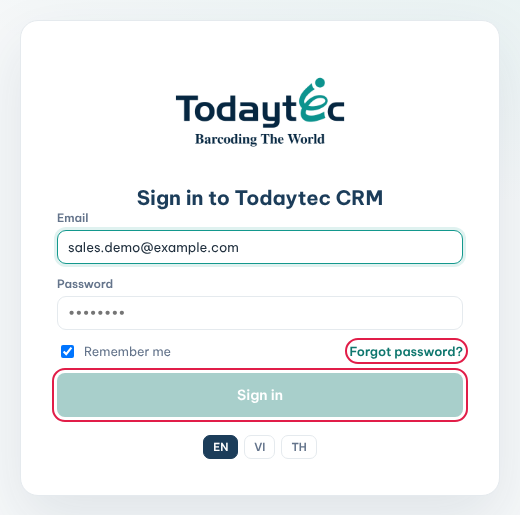
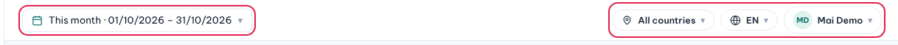
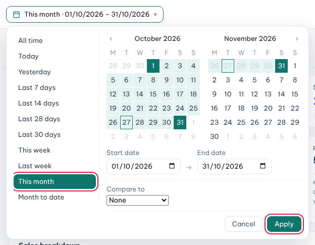

Todaytec CRM is where you keep your customers, projects, quotations and POs in one place.

### Sign in

1. Open the CRM link in your browser.
2. Type your work **Email** and **Password**.
3. Leave **Remember me** ticked on your own computer.
4. Click **Sign in**.

After 10 wrong passwords, the CRM locks sign-in for 15 minutes.

### Forgot your password

1. On the sign-in screen, click **Forgot password?**.
2. Type your email and click **Send reset link**.
3. Open the email and click the link. It works for 30 minutes.
4. Type it in **New password** and **Confirm password**, then click **Update password**.
5. Click **Go to sign in** and sign in with the new password.

### The top bar

- **Date range** (left): every page opens on **This month**. Click it to pick another period.
- **Country**: shows **All countries** when you cover more than one market. Pick one market to narrow every page.
- **Language**: switch between **EN**, **VI** and **TH**.
- **Your name**: click it for **View profile** and **Sign out**.

### Change the date range

1. Click the date button on the left of the top bar.
2. Pick a preset, such as **Last month** or **Year to date**.
3. Or click a start day and an end day on the calendar.
4. Optional: choose a period in **Compare to**.
5. Click **Apply**.

### Update your profile

1. Click your name, then **View profile**.
2. In **My profile**, change your name, phone or photo (**Upload photo**).
3. Click **Save**.

### The sidebar

- The sidebar lists only the modules you have access to.
- Indented items belong to the item above them. For example, **Pipelines**, **Samples** and **Quotations** sit under **Projects**.
- Clicking a module in the sidebar always brings you back to its list.
- Click **‹** at the top to hide the sidebar. Click **›** to show it again.

**Tips**

- The date range and country apply to every page at once.
- Your language choice stays on this browser.
