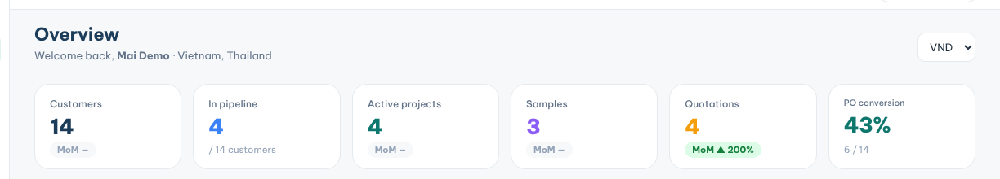

**Overview** is your dashboard: it shows how your customers, projects and sales are doing for the chosen period.

### Read your numbers

1. Set the period with the date range in the top bar.
2. Read the top counters: **Customers**, **In pipeline**, **Active projects**, **Samples**, **Quotations** and **PO conversion**.
3. Check the value cards: **Total value**, **PO value**, **Project value** and **Forecast value**.
4. Each value card shows **MTD**, **QTD** and **YTD**, with the change against the last period.

### Drill into the details

1. Click an **MTD**, **QTD** or **YTD** figure on **PO value** to open those POs in **PO List**.
2. Scroll to **Sales breakdown** to see your sales by company, sales rep, product and customer type.
3. Type in a table's search box to find one company or product.
4. In **Re-order radar**, click **View all →** to open **Retention**.
5. In **Running projects**, click a project to open it.

**Tips**

- **Upcoming meetings** lists the meetings you logged on customer profiles.
- Numbers only include the customers you are allowed to see.
