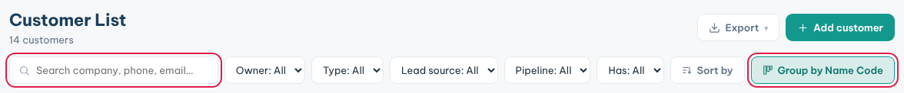
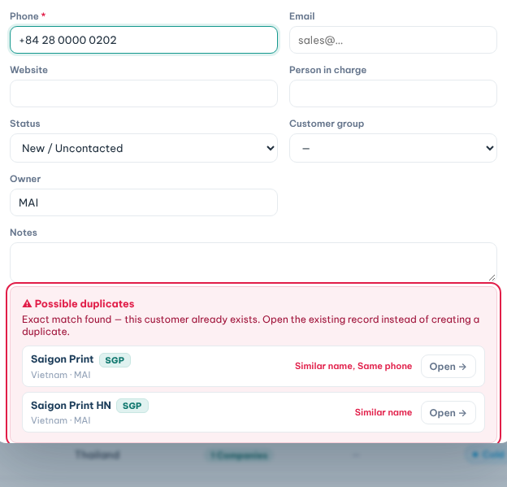
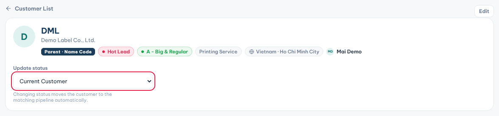

**Customers** holds every company you sell to, with its contacts, status and history.

### Find a customer

1. Click **Customers** in the sidebar.
2. Type a company name, phone, email, Business ID or PO number in the search box.
3. Narrow the list with **Type**, **Lead source**, **Pipeline** or **Has** (**Has projects** / **Has PO**).
4. Use **Sort by** to order the list.

**Group by Name Code** is on by default. Companies with the same Name Code show as one row.

- Click the row or its arrow to see the companies under it.
- Click **View detail →** to open the customer profile.
- Click **Group by Name Code** again to see one row per company.

### Add a customer

1. Click **Add customer**.
2. Type the **Company** name. The CRM suggests a code in **Name Code**.
3. Keep the suggestion, pick an existing code to join that group, or type a new one.
4. Fill **Country**, **Type** and **Phone**. They are required.
5. Add the **Business ID** if you have it. The hint shows the right length per country.
6. Click **Create customer**.

The CRM checks for duplicates while you type.

- **Similar records found**: check the list, then create the customer if it is really new.
- **Exact match found** (same name, Business ID, phone or email): you cannot create it. Click **Open →** to use the existing record.

### Work on a customer profile

1. Open the customer from the list.
2. Pick a new status in **Update status**.
3. The customer moves to the matching pipeline stage. For example, **Quotation / Quote** moves it to **Warm Lead**.

The profile also shows the customer's companies, contacts, projects, POs, samples, quotations and retention.

- Click **New project** or **New PO** on the profile to start one for this customer.
- Click **Edit** at the top right to change the customer details.

### Log contacts and set the next action

1. Scroll down to **Interaction timeline**.
2. Pick **Note**, **Call**, **Meeting** or **File**.
3. For a call, choose the outcome, such as **Connected** or **No answer**.
4. For a meeting, choose the date and time.
5. Type what happened and click **Log it**.
6. Fill **Next action date** and **Next action note**. They save when you click outside the box.

**Tips**

- Meetings you log appear in **Upcoming meetings** on **Overview**.
- A **No contact in 14+ days** flag means it is time to call this lead.
- Status changes are logged in the timeline automatically.
