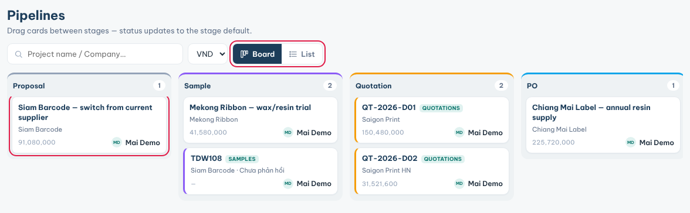

**Pipelines** shows your projects as cards on a board, one column per stage.

### See where your deals are

1. Click **Pipelines** in the sidebar.
2. Read the columns from left to right: **Proposal**, **Sample**, **Quotation**, **PO**, **Won** and **Lost**.
3. The number on each column is how many cards it holds.
4. Type a project or company name in the search box to find one card.
5. Click **List** to see the same projects as tables. Click **Board** to go back.

### Move a project to the next stage

1. Drag the project card to its new column.
2. Drop it. The project's stage changes at once.
3. Click a project card to open the project.

**Tips**

- Cards tagged **SAMPLES** and **QUOTATIONS** come from the Samples and Quotations modules. You cannot drag them. Clicking them opens the customer.
- Moving a card needs **Edit** access on Pipelines.
- The board follows the date range in the top bar. Widen it if a project is missing.
