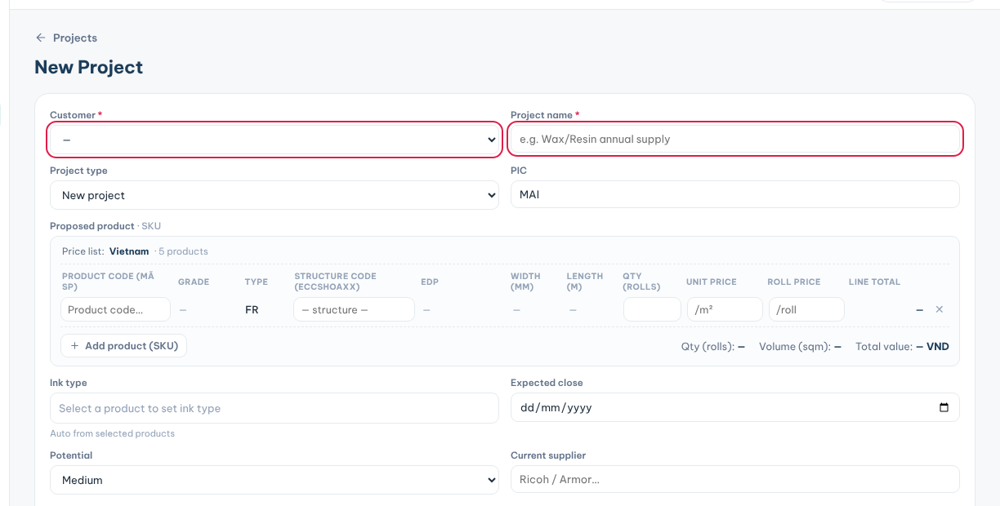
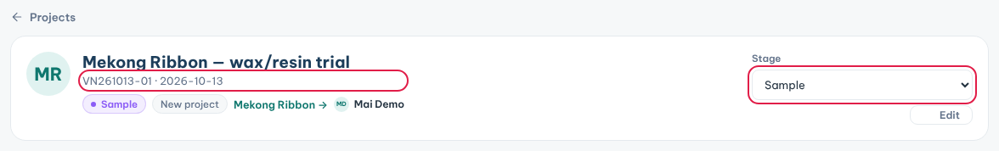

**Projects** tracks each sales opportunity with a customer, from the first proposal to the PO.

### Create a project

1. Click **Projects** in the sidebar, then **New Project**.
2. Pick the **Customer**, or choose **➕ New customer** and type its name.
3. Type the **Project name**.
4. Pick the **Project type**: **New project**, **Resupply** or **Conversion**.
5. Under **Proposed product · SKU**, type a product code and pick it from the list. Add the quantity.
6. Fill what you know: **Expected close**, **Potential**, **Current supplier**, **Win probability (%)**.
7. Click **Create project**.

**Ink type** fills itself in from the products you pick.

Each new project gets a code: country, date and number, such as **VN261027-01** or **TL261027-02**.

### Move a project forward

1. Open the project from the list.
2. Pick the new **Stage**: **Proposal**, **Sample**, **Quotation**, **PO**, **Won** or **Lost**.
3. The change is saved and logged on the customer's timeline.
4. Click **Edit** to change other details.

### Find a project

1. Type a company name or Business ID in the search box.
2. Filter by **Stage**.
3. Click the customer name to open the customer instead of the project.

**Tips**

- When a project closes, fill **Project result** in the project form.
- Projects also show on the customer profile. You can start one there with **New project**.
