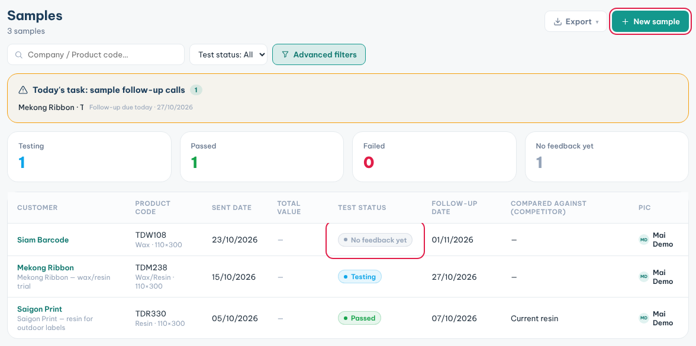
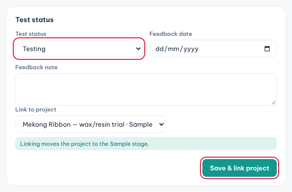

**Samples** tracks the test rolls you send to customers and what they thought of them.

### Log a sample you sent

1. Click **Samples** in the sidebar, then **New sample**.
2. Pick the customer and, if there is one, the linked project.
3. Add the product code and quantity.
4. Fill **Sent date**, **Courier** and **Tracking no.**.
5. Check the **Follow-up date**. It is set to 14 days after the sent date.
6. Click **New sample**.

### Record the customer's feedback

1. Open the sample from the list.
2. In **Test status**, pick **Passed**, **Failed**, **Testing** or **No feedback yet**.
3. Fill **Feedback date** and **Feedback note**.
4. Pick the project in **Link to project** if it is not linked yet.
5. Click **Save & link project**.

### Follow up on time

1. Check the card **Today's task: sample follow-up calls** at the top of the page.
2. **Follow-up due today** means call today. **Follow-up overdue** means the date has passed.
3. Call each customer on the list and record the feedback.
4. Use **Test status** or **Advanced filters** to see only the samples you need.

**Tips**

- Linking a sample moves the project to the **Sample** stage.
- The counters at the top show how many samples are testing, passed, failed or without feedback.
