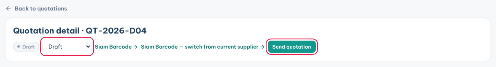
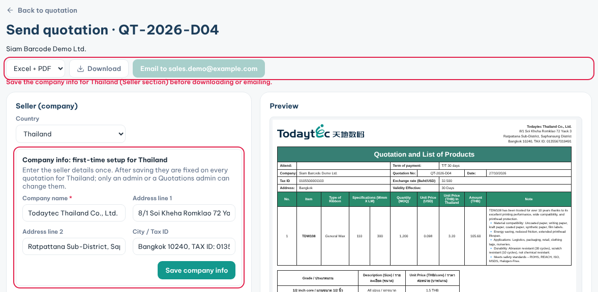
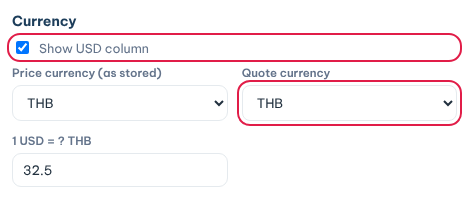
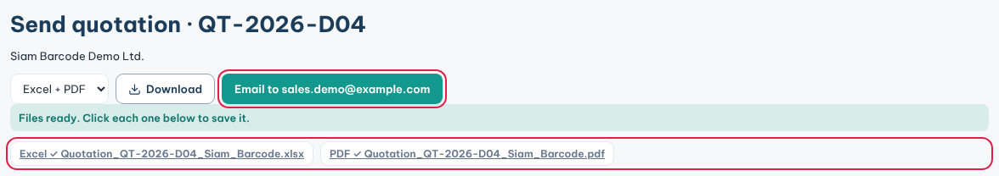

**Quotations** is where you price a deal, track its status and send the quote to your customer.

### Create a quotation

1. Click **Quotations** in the sidebar, then **New quotation**.
2. Pick the **Customer**, or choose **➕ New customer**.
3. Optional: pick the project in **Link to project**.
4. Check **Quote date**, **Valid until** and **Payment terms**.
5. Under **Line items**, type a product code and pick it from the list.
6. Pick the **Structure code**, then type the **Qty (rolls)** and the **Unit price** per m².
7. Click **+ Add product (SKU)** for more lines.
8. Click **New quotation** to save.

The **Roll price** and **Line total** are worked out for you. You can type a roll price instead.

### Open and update a quotation

1. In the list, click the quotation row or the customer name. Both open the quotation detail.
2. Change the **Status**: **Draft**, **Sent**, **Negotiating**, **Won** or **Lost**.
3. Click **Edit** on **Line items** to change products or prices.
4. Pick a project under **Link to project** and click **Save & link project**.

A customer with several quotations shows as one row. Click it to see them all.

### Send the quotation

1. On the quotation detail, click **Send quotation**.
2. Under **Seller (company)**, check the **Country**.
3. If you see **Company info: first-time setup**, fill in your company details once.
4. Click **Save company info**. From then on they are fixed for that country.
5. Check **Customer & terms**, such as **Attend** and **Term of payment**.
6. Under **Currency**, pick the **Quote currency** and check the USD rate.
7. Untick **Show USD column** if the customer should not see USD prices.
8. Under **Products**, adjust the **MOQ**, the unit price or the product note if needed.
9. Check the **Preview** on the right.

### Download or email it

1. Pick the file type at the top: **Excel + PDF**, **Excel** or **PDF**.
2. Click **Download**. One file saves at once.
3. With **Excel + PDF**, the two files appear as links under the buttons. Click each link to save it.
4. Or click **Email to** your address. The files come to your own inbox.
5. Forward that email to the customer.

**Tips**

- Download and email stay disabled until the seller company is saved for that country.
- Once saved, only an admin or someone with **Admin** level on Quotations can change the seller company. Ask them if it is wrong.
- Your changes on **Send quotation** are kept for the next time you send this quote.
- When a quote is **Won**, create the PO from it. See **PO List**.
