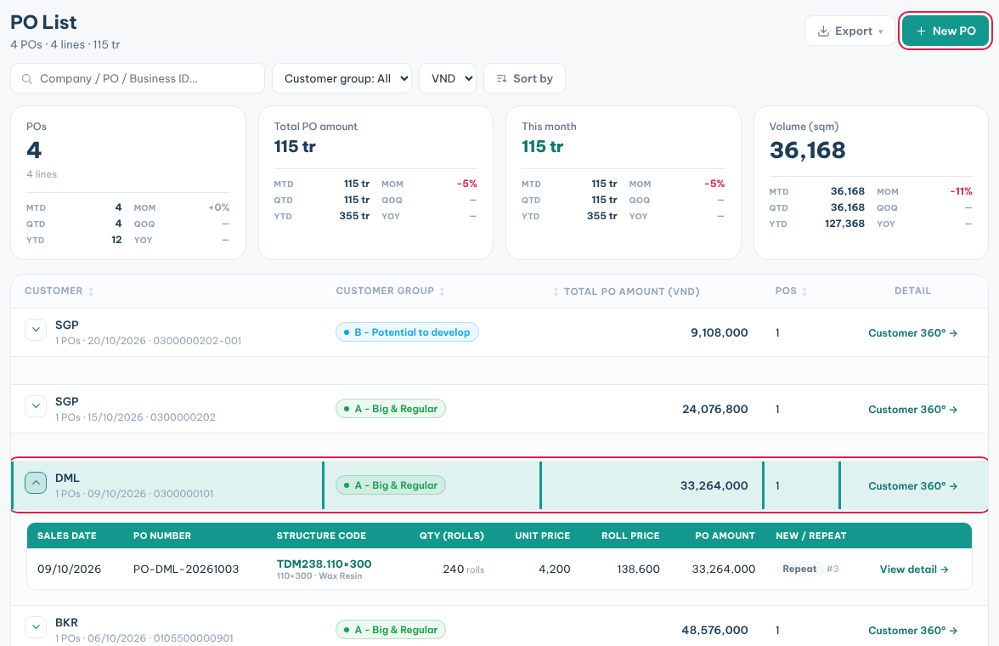
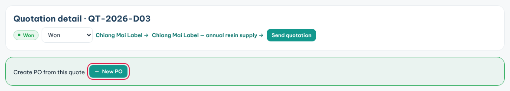
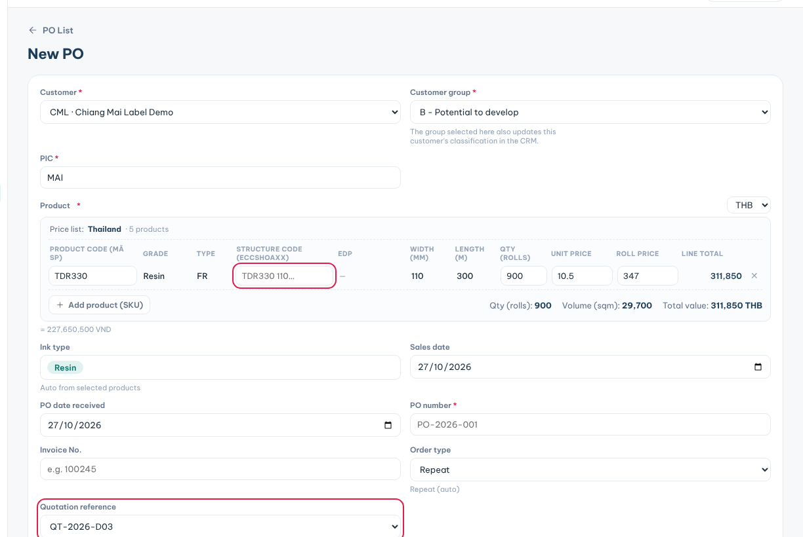

**PO List** records every purchase order your customers place, so sales and targets stay up to date.

### Find a PO

1. Click **PO List** in the sidebar.
2. Set the period with the date range in the top bar.
3. Type a company name, PO number or Business ID in the search box. Search covers all dates.
4. Click the arrow on a customer row to see its POs.
5. Click **View detail →** to open one PO. Click **Customer 360° →** to open the customer.

### Create a PO from a won quotation

1. Open the quotation and set its **Status** to **Won**.
2. In the green box **Create PO from this quote**, click **New PO**.
3. The New PO form opens with the customer, currency, first product line and **Quotation reference** filled in.
4. Check the **Structure code** on each line and pick it if it is empty.
5. Add any other lines from the quotation with **+ Add product (SKU)**.
6. Type the **PO number** and check the **Sales date**.
7. Click **New PO** to save.

### Create a PO without a quotation

1. Click **New PO**.
2. Pick the **Customer**, **Customer group** and **PIC**.
3. Add the products, quantities and prices.
4. Type the **PO number**. Add the **Invoice No.** if you have it.
5. Under **Attachments (PO proof)**, upload the customer's PO file or photo.
6. Click **New PO**.

**Tips**

- Only the first line of a quotation is copied into the PO. Add the other lines yourself.
- The **Customer group** you pick also changes the customer's group in the CRM.
- **Order type** (**New** or **Repeat**) is set for you from the customer's PO history.
