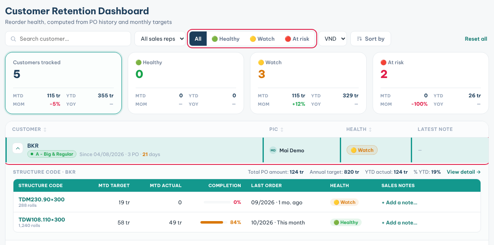

**Retention** warns you which customers are late with their next order, so you can call them before they leave.

### Find customers who need a call

1. Click **Retention** in the sidebar.
2. Click **🔴 At risk** or **🟡 Watch** to see only those customers.
3. Or click a counter card, such as **At risk**, to filter the list. Click it again to clear.
4. Use **Search customer…** to find one company.

The health colours mean:

- **🟢 Healthy**: ordering on schedule and near or above target.
- **🟡 Watch**: the order is overdue or below target.
- **🔴 At risk**: well overdue and well below target.

### See what a customer buys

1. Click the customer row.
2. Read **Total PO amount**, **Annual target**, **YTD actual** and **% YTD**.
3. Check each **Structure code**: its **Last order**, **Completion** and **Health**.
4. Click **View detail →** to open the customer profile.

### Leave a note

1. In the opened customer row, click **+ Add a note…** next to a product.
2. Type what you agreed with the customer.
3. Press **Enter** or click **Save**.

**Tips**

- Health is worked out from the customer's PO history and monthly targets.
- Your note is also copied to the customer's activity log.
- Click **Reset all** to clear every filter.
