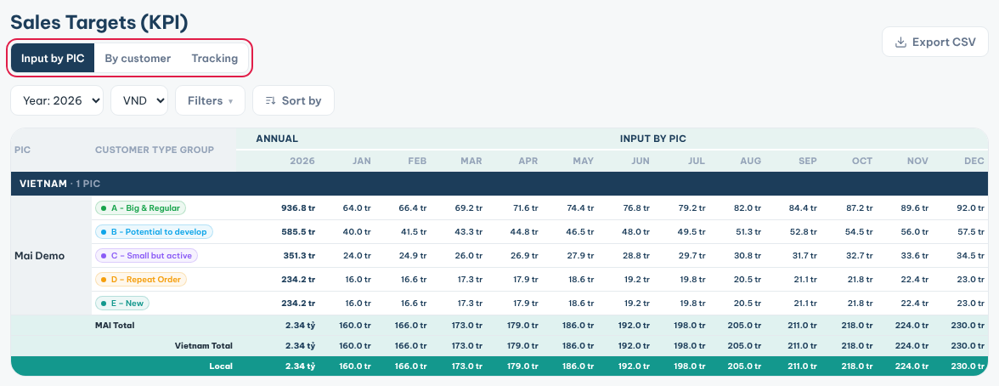
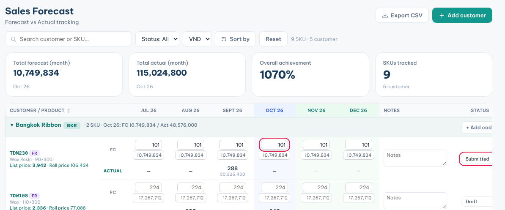

**Targets** holds your sales targets (KPI). **Sales Forecast** predicts next months' orders per customer and product.

### Check your targets

1. Click **Targets** in the sidebar.
2. Pick the **Year** and the currency.
3. **Input by PIC** shows your monthly targets per customer type group.
4. **By customer** shows the plan per customer and product. Click the arrow on a customer to see its items.
5. **Tracking** compares target and actual: **MTD Tracking**, **Previous month (Act)** and **YTD Tracking**.

### Enter a target

1. Open **Input by PIC** or **By customer**.
2. Click a month cell.
3. Type the amount in the currency shown on the page, then press **Enter**.

You need **Edit** access on Targets to type in the cells. Actuals come from **PO List**.

### Fill in your forecast

1. Click **Sales Forecast** in the sidebar.
2. Each customer shows the products it bought, with **FC** (forecast) and **ACTUAL** rows per month.
3. Type the forecast quantity in the **FC** cell for the current or a future month. The value fills in from the list price.
4. Add a note in **Notes** if needed.
5. Set **Status** to **Submitted** when the numbers are final.

### Add a customer or a product to the forecast

1. Click **Add customer** to forecast a customer that has no PO yet.
2. Click **+ Add code** on a customer row to add another product.
3. Pick from **Codes already bought** or **Never bought**.

**Tips**

- Greyed numbers in the **FC** cells are only suggestions: the latest actual × 35%.
- **Total forecast (month)** counts only rows set to **Submitted** or **Locked**.
- Submitted and Locked rows also show on **Overview** as **Submitted forecast**.
- A **Locked** forecast can no longer be edited.
