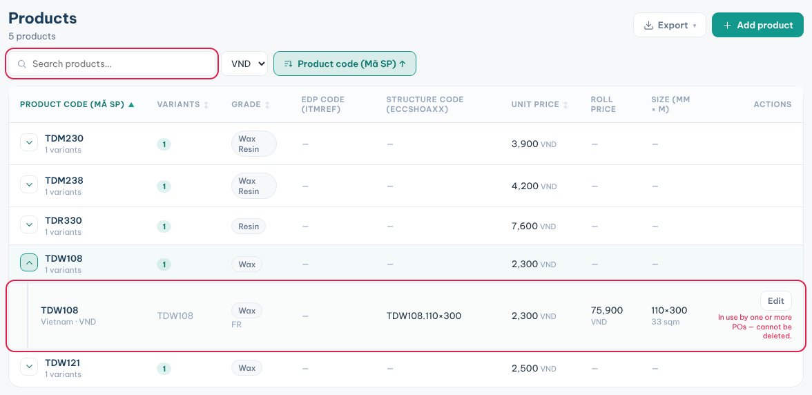

**Products** is the price list: every ribbon code with its grade, size and price for each country.

### Look up a product or price

1. Click **Products** in the sidebar.
2. Pick the market in the top bar. The list and currency follow it.
3. Type a code, name or structure code in **Search products…**.
4. Click the arrow on a product code to see its variants.
5. Read the **Unit price** (per m²), **Roll price** and **Size (mm × m)**.

### Add or change a product

1. Click **Add product**, or **Edit** on a variant row.
2. Fill **Commercial name**, **Product code**, **Grade** and **Country**.
3. Fill the **Structure code**, **Width (mm)** and **Length (m)**. The m² per roll fills in.
4. Type the **Unit price** and pick the **Currency**. The roll price is worked out.
5. Click **Save**.

**Tips**

- Quotations, projects and POs take their product list and prices from here.
- Pick another currency in the toolbar to see prices converted.
- A product used by a PO cannot be deleted.
