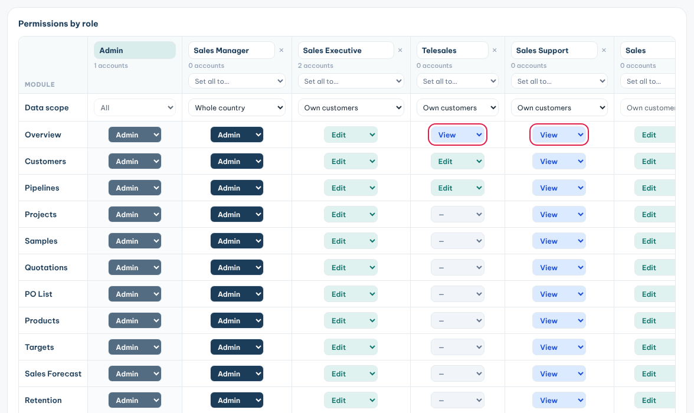

Your access level decides what you can see and do in each module of the CRM.

### What the access levels allow

Your admin sets one level per module for your role.

| Level | What you can do |
|---|---|
| **—** | The module is hidden from your sidebar. |
| **View** | Open and read the module, and use **Export**. |
| **Edit** | Everything in **View**, plus create and edit records. |
| **Admin** | Everything in **Edit**, plus delete, **Import Excel** and maintenance actions. |

Your **Data scope** decides whose records you see:

- **Own customers**: only your own customers and their records.
- **Whole country**: every customer in your country.
- **All**: every record, in every country.

### FAQ

**Why can't I see a button?**

Buttons you are not allowed to use are hidden. For example, **Import Excel** and **Delete** need **Admin**. **New …** buttons need **Edit**. Some fields show but are greyed out, like a status you can only read.

**Why is a customer or PO missing?**

1. Check the date range in the top bar. Try **All time**.
2. Check the country in the top bar. Try **All countries**.
3. Clear the search box and filters.
4. If it is still missing, it may belong to another sales rep. Ask your manager.

**What is the More (⋯) button?**

It holds admin actions, such as deleting many records at once. It only shows if your level allows them.

**How do I reset my password?**

1. On the sign-in screen, click **Forgot password?**.
2. Type your email and click **Send reset link**.
3. Open the link in the email within 30 minutes and set a new password.

**I forgot my password and the email does not arrive.**

Check your spam folder. Then ask your admin to set a new password for you.

**Who do I ask?**

- Access, roles and passwords: your CRM admin.
- Which customers are yours: your sales manager.
- Wrong seller company details on a quotation: your CRM admin.
